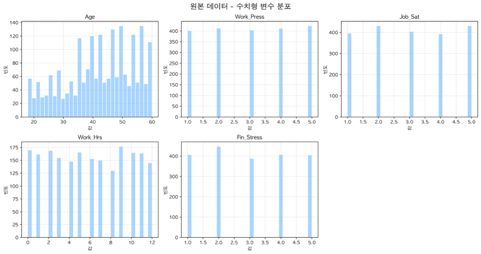
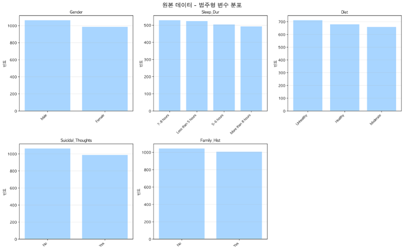
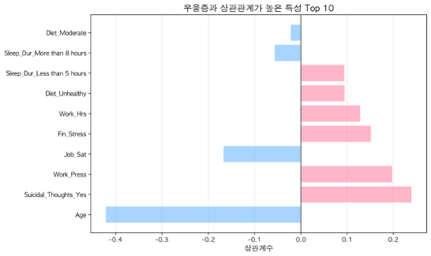
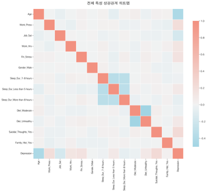
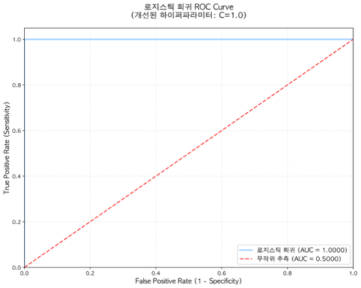
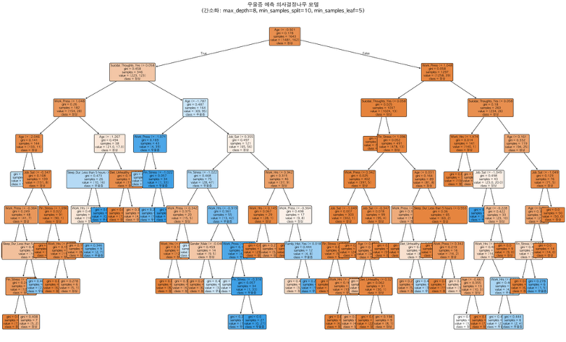
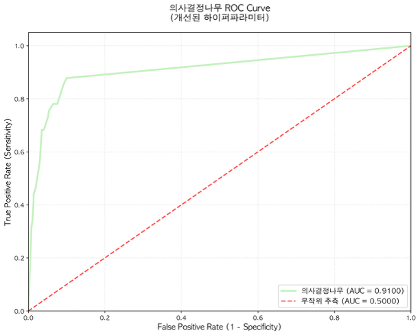

생활·업무 요인과 우울증의 관계를 분석하고 분류 모델을 만들었다.

## 프로젝트 개요

전처리·EDA 후 로지스틱 회귀, 의사결정나무, K-Means를 적용했다.

분석 범위는 다음과 같다.

* 생활·업무 요인과 우울증 여부의 관련성.
* 회귀·트리 모델의 분류 성능.
* 군집별 우울증 비율과 변수 조합.
* 결과의 활용 가능성.

## 데이터 구성

데이터는 2,054개 샘플과 11개 컬럼이다. 타깃은 `Depression`이다.

| 구분 | 내용 |
| --- | --- |
| 샘플 수 | 2,054개 |
| 변수 수 | 11개 |
| 타겟 변수 | Depression |
| 우울증 없음 | 1,851명 |
| 우울증 있음 | 203명 |
| 우울증 비율 | 약 9.9% |

생활·업무 변수와 우울증 여부를 사용했다. `Yes`·`No`는 이진 값으로 바꿨다.

| 변수 | 설명 |
| --- | --- |
| Gender | 성별 |
| Age | 나이 |
| Work Pressure | 업무 압박감 |
| Job Satisfaction | 직업 만족도 |
| Sleep Duration | 수면 시간 |
| Dietary Habits | 식습관 |
| Have you ever had suicidal thoughts ? | 자살 생각 여부 |
| Work Hours | 근무 시간 |
| Financial Stress | 재정 스트레스 |
| Family History of Mental Illness | 가족의 정신질환 이력 |
| Depression | 우울증 여부 |

## 전처리 및 탐색적 데이터 분석

### 컬럼 정리 및 결측치 처리

컬럼명을 줄였다. `Work Pressure`는 `Work_Press`, `Job Satisfaction`은 `Job_Sat`, `Financial Stress`는 `Fin_Stress`로 바꿨다.

결측치는 없었다. 코드에는 수치형 중앙값·범주형 최빈값 대체를 남겼다.

```python
# 타겟 변수 분리
X = df.drop(columns=[target_col])
y = df[target_col]

# 타겟 변수 이진 변환
if y.dtype == 'object':
    y = y.map({'Yes': 1, 'No': 0})
```

### 인코딩, 분할, 표준화

범주형은 원핫 인코딩했다. 학습·테스트는 80:20으로 나누고, `stratify=y`로 클래스 비율을 유지했다.

```python
X_train, X_test, y_train, y_test = train_test_split(
    X,
    y,
    test_size=0.2,
    random_state=42,
    stratify=y
)
```

`StandardScaler`로 표준화했다. 테스트 변환에는 학습 데이터의 평균·표준편차만 썼다.

### 분포 및 상관관계 확인

우울증 표시는 203개(약 9.9%), 나머지는 1,851개다. 클래스 불균형 때문에 정확도 외의 지표도 확인했다.





나이, 자살 생각, 업무 압박감, 직업 만족도, 재정 스트레스, 근무 시간이 우울증 여부와 높은 관련성을 보였다.

| 순위 | 변수 | 상관계수 | 해석 |
| --- | --- | --- | --- |
| 1 | Age | -0.4213 | 나이가 많을수록 우울증 위험 감소 |
| 2 | Suicidal_Thoughts_Yes | 0.2392 | 자살 생각이 있으면 우울증 위험 증가 |
| 3 | Work_Press | 0.1975 | 업무 압박감이 높을수록 우울증 위험 증가 |
| 4 | Job_Sat | -0.1669 | 직업 만족도가 높을수록 우울증 위험 감소 |
| 5 | Fin_Stress | 0.1516 | 재정 스트레스가 높을수록 우울증 위험 증가 |
| 6 | Work_Hrs | 0.1284 | 근무 시간이 길수록 우울증 위험 증가 |





회귀·트리 모델로 예측 성능과 변수별 관련성을 비교했다.

## 모델링

로지스틱 회귀를 기준으로 의사결정나무를 비교했다. K-Means는 군집별 특성 확인에 사용했다.

### 로지스틱 회귀

회귀 계수와 오즈비율로 변수별 관련성을 해석했다.

```python
def train_logistic_regression(X_train, y_train, max_iter=1000, random_state=42):
    model = LogisticRegression(max_iter=max_iter, random_state=random_state)
    model.fit(X_train, y_train)
    return model
```

| 순위 | 변수 | 계수 | 해석 |
| --- | --- | --- | --- |
| 1 | Age | -10.8567 | 나이가 많을수록 우울증 위험 감소 |
| 2 | Suicidal_Thoughts_Yes | 7.0929 | 자살 생각이 있으면 우울증 위험 증가 |
| 3 | Job_Sat | -5.5227 | 직업 만족도가 높을수록 우울증 위험 감소 |
| 4 | Work_Press | 5.4559 | 업무 압박감이 높을수록 우울증 위험 증가 |
| 5 | Fin_Stress | 4.2683 | 재정 스트레스가 높을수록 우울증 위험 증가 |
| 6 | Work_Hrs | 3.3442 | 근무 시간이 길수록 우울증 위험 증가 |

테스트 데이터의 혼동 행렬이다.

| 구분 | 예측 No | 예측 Yes |
| --- | --- | --- |
| 실제 No | 369 | 1 |
| 실제 Yes | 0 | 41 |

테스트 정확도는 99.76%, ROC AUC는 1.0000이었다.



### 의사결정나무

`max_depth`, `min_samples_split`, `min_samples_leaf`를 조정해 과적합을 줄였다.



| 변수 | 중요도 |
| --- | --- |
| Age | 38.3% |
| Suicidal_Thoughts_Yes | 13.68% |
| Job_Sat | 12.13% |
| Work_Press | 10.50% |
| Work_Hrs | 9.46% |
| Fin_Stress | 9.29% |

정확도는 92.94%, AUC는 0.9100이었다. 분류 조건은 트리로 확인했다.



같은 샘플의 예측 확률이 회귀 100.0%, 트리 33.3%로 달랐다.

회귀의 `C`를 10.0에서 1.0으로 낮추고, 트리에 `min_samples_leaf=5`를 적용했다.

| 모델 | 개선 전 | 개선 후 | 개선 효과 |
| --- | --- | --- | --- |
| 로지스틱 회귀 | 100.0% | 97.6% | 극단적 확률 완화 |
| 의사결정나무 | 33.3% | 71.4% | 소수 샘플 문제 완화 |
| 모델 간 차이 | 66.7%p | 26.2%p | 40.5%p 감소 |

조정 후 두 모델의 예측 방향이 같아졌다.

### 클러스터링

전체 변수로 군집화하면 타깃과 강한 관련이 있는 변수에 따라 단순 분리됐다.

회귀에서 우울증과 양의 관련을 보인 변수만 골라 K-Means를 적용했다.

* Suicidal_Thoughts_Yes
* Work_Press
* Fin_Stress
* Work_Hrs
* Diet_Unhealthy
* Family_Hist_Yes
* Sleep_Dur_Less than 5 hours

Elbow Method·Silhouette Score와 해석 가능성을 고려해 `k=3`으로 정했다.

| 클러스터 | 크기 | 우울증 수 | 우울증 비율 | 해석 |
| --- | --- | --- | --- | --- |
| 0 | 748명 | 60명 | 8.0% | 직무 스트레스와 수면 부족 중심 |
| 1 | 525명 | 77명 | 14.7% | 근무 시간과 자살 생각 중심의 고위험 그룹 |
| 2 | 781명 | 66명 | 8.5% | 자살 생각과 재정 스트레스 중심 |

<!-- 이미지 삽입: 최적 클러스터 수 결정 그래프 -->
<!-- 이미지 삽입: PCA 기반 클러스터 시각화 -->
<!-- 이미지 삽입: 클러스터별 우울증 비율 -->
<!-- 이미지 삽입: 클러스터별 특성 프로파일 -->

군집 1의 우울증 비율은 14.7%로 전체 9.9%보다 높았다. 근무 시간과 자살 생각 변수도 높게 나타났다.

Silhouette Score가 높지 않아 군집은 보조 해석에만 사용했다.

## 활용 방안

활용 대상으로 검토한 범위다. 실제 적용에는 별도 검증이 필요하다.

* 초기 우울증 위험 선별을 위한 보조 지표
* 직장 내 멘탈 케어 및 스트레스 관리 프로그램
* 고위험 그룹 대상 맞춤형 상담 및 예방 프로그램
* 근무 시간, 재정 스트레스, 수면 부족 등 생활 요인 기반 관리 전략
* 지역사회 또는 학교 단위의 정신건강 지원 프로그램 기획

두 모델에서 공통으로 중요한 변수는 나이·자살 생각·직업 만족도·업무 압박감이었다.

## 한계점

- 우울증 샘플은 약 9.9%다. 재현율·F1-Score를 함께 봐야 한다.

- 상관관계와 회귀 계수는 인과관계를 뜻하지 않는다.

- 군집 간 구분이 뚜렷하지 않았다.

- 실제 의료·상담 적용에는 외부 데이터 검증과 전문가·윤리 검토가 필요하다.

## 회고

정확도 외에 클래스 불균형과 변수 해석을 함께 확인했다.

회귀 계수와 트리 조건으로 결과를 설명했다. 군집은 구분이 뚜렷하지 않아 보조 도구로 남겼다.
