QR 자재 호출을 ERP 데이터와 연결한 재고·자재 요청 관리 시스템.

## 프로젝트 개요

SSD 생산 라인의 자재 호출 시스템을 만들었다. 작업자는 QR로 요청하고, 관리자는 재고·작업지시·BOM을 확인해 처리한다.

전화·메신저 요청의 누락과 기록 부재를 줄이기 위해 요청을 DB에 저장하고 처리 상태를 관리했다.

## 데이터셋 및 DB 구성

더존 ERP 실습 DB에 프로젝트용 스키마와 테이블을 추가했다. 회사 기준 정보를 새로 만드는 작업은 범위에서 제외했다.

수천 개의 기존 테이블과 구분해 `erp` 스키마에 자재 요청·작업지시·BOM·재고·구매주문·출하·거래처 테이블을 구성했다.

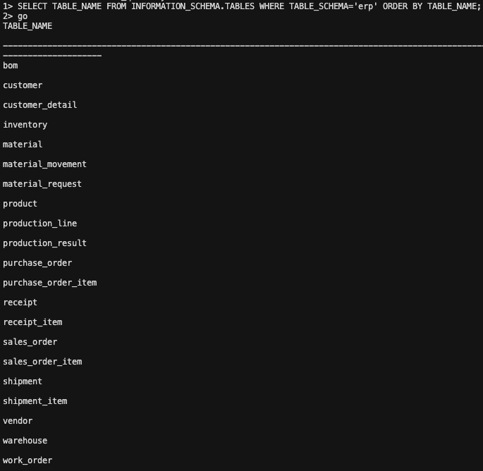

| 구분 | 테이블 | 역할 |
| --- | --- | --- |
| 기준 정보 | material, product, customer, vendor | 자재, 제품, 거래처, 공급업체 기준 데이터 |
| 생산 정보 | work_order, bom, production_line, production_result | 작업지시, 제품별 자재 명세서, 생산 라인, 생산 결과 |
| 구매 및 자재 | material_request, purchase_order, purchase_order_item | 현장 자재 호출과 구매 요청 처리 |
| 재고 및 이동 | inventory, material_movement, warehouse | 창고/라인별 재고와 이동 이력 |
| 판매 및 출하 | sales_order, shipment, receipt | 판매 주문, 출하, 입고 기록 |

삼성 SSD 생산 라인을 가정했다. 품목은 SSD Controller, DRAM Cache, V-NAND Flash, PCB Board, 알루미늄 케이스 등이다.

## 데이터 적재 및 누적 확인

자재 요청·구매주문·작업지시·재고 저장과 대시보드 집계를 확인했다.

QR 요청을 자재 호출 이력에 저장했다. `MAT-CASE` 요청에는 요청번호·작업지시번호·수량·상태·시각·라인·공정·사유가 남는다.

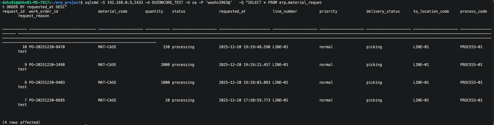

요청 처리 후 구매주문이 추가됐다. 기존 2024년 주문과 새 2025년 주문을 함께 조회하고, 주문번호·공급업체·주문일·납기일·생성 시각을 확인했다.

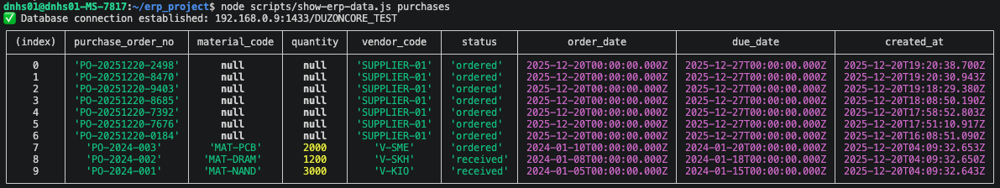

작업지시에는 제품 코드·수량·라인·상태·우선순위·시작일·납기일을 저장했다.

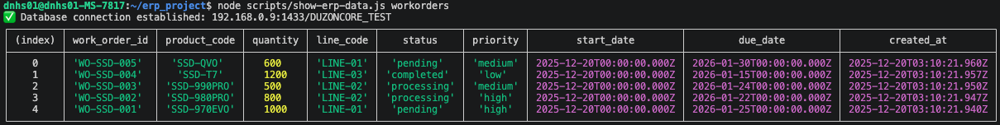

재고는 자재 코드와 위치별로 저장했다. `LINE`과 `WAREHOUSE`를 나눠 라인·창고 수량을 구분했다.

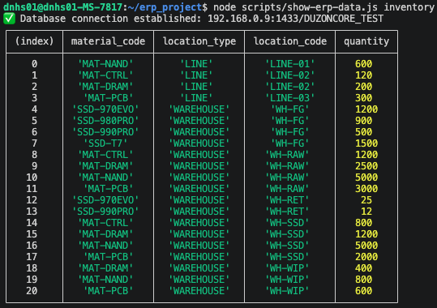

누적 데이터를 집계해 작업지시 상태별 건수, 구매주문 수, 전체·창고별 재고를 표시했다.

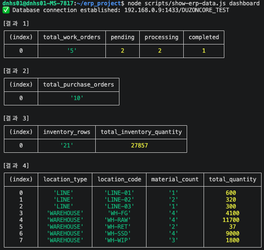

데이터 흐름은 다음과 같다.

| 원천 데이터 | 누적되는 내용 | 분석 활용 |
| --- | --- | --- |
| 자재 호출 | 요청 자재, 수량, 라인, 공정, 요청 사유, 상태 | 미확인 호출 수, 반복 호출 자재, 처리 지연 확인 |
| 구매주문 | 주문번호, 공급업체, 주문일, 납기일 | 구매 이력 추적, 공급업체별 주문 현황 |
| 작업지시 | 제품, 수량, 상태, 우선순위, 라인, 납기일 | 작업 상태별 비율, 납기 준수율 |
| 재고 | 자재 코드, 창고/라인 위치, 수량 | 창고 재고와 라인 재고 비교, 부족 자재 탐지 |
| 판매/출하 | 고객, 제품, 주문, 출하 상태 | 고객별 판매 실적, 출하 상태 분석 |

## 시스템 구조 및 워크플로우

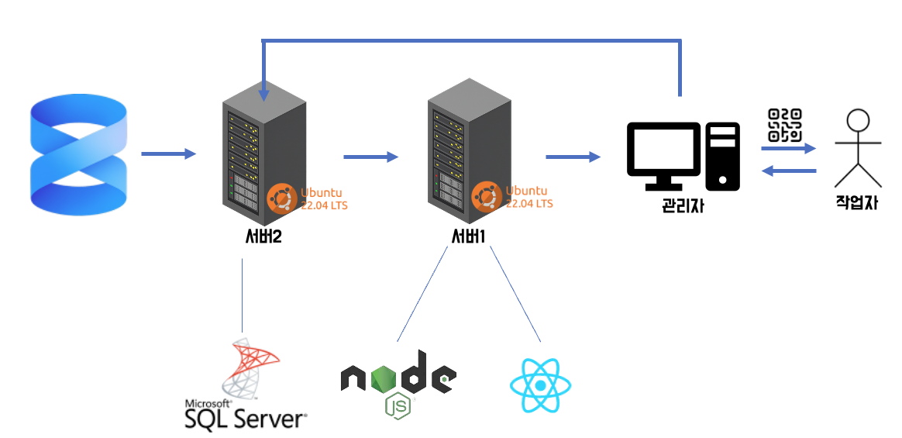

서버 2는 MSSQL로 ERP 데이터를 관리하고, 서버 1은 Node.js API와 React 화면을 실행한다. 관리자가 QR을 생성하면 작업자는 이를 스캔해 공정별 자재 호출 화면에 접속한다.

| 구성 요소 | 역할 |
| --- | --- |
| 작업자 모바일 화면 | QR 스캔 후 라인/공정별 자재 호출 등록 |
| 관리자 웹 대시보드 | 호출 내역 확인, 상태 변경, 작업지시 및 재고 확인 |
| Node.js API 서버 | 요청 검증, DB 조회/등록/수정, 트랜잭션 처리 |
| MSSQL 서버 | 자재, 재고, 작업지시, BOM, 요청 이력 저장 |

요청은 서버 1 API를 거쳐 서버 2 MSSQL에 `pending`으로 저장된다. 관리자는 재고·BOM을 확인하고 상태를 변경한다.

QR에는 로컬 주소를 넣어 같은 Wi-Fi에서 접속하도록 했다. 네트워크 변경 시 QR 재발급이나 VPN 사용을 고려했다.

## 작업자 자재 호출

QR에 라인 번호와 공정 코드를 고정했다. 작업자는 자재 코드·수량·사유만 입력한다.

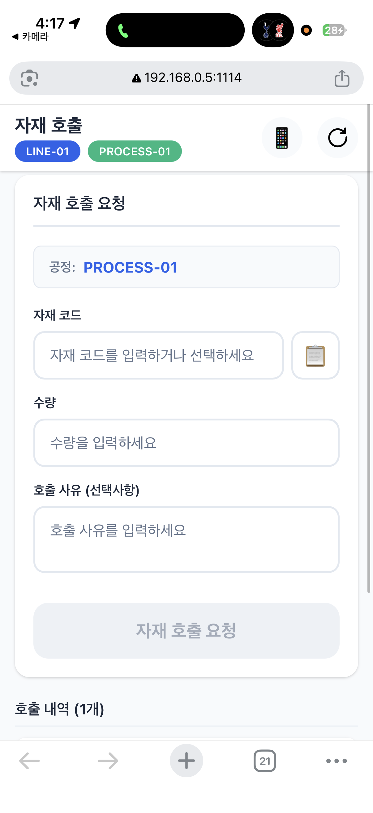

요청은 대기 상태로 저장된다. 관리자 대시보드와 구매/자재 메뉴에서 확인할 수 있다.

## 관리자 대시보드

대시보드에 작업지시 상태별 건수, 자재 재고, 구매주문, 생산 라인 수를 표시했다. 미확인 호출은 상단에 알렸다.

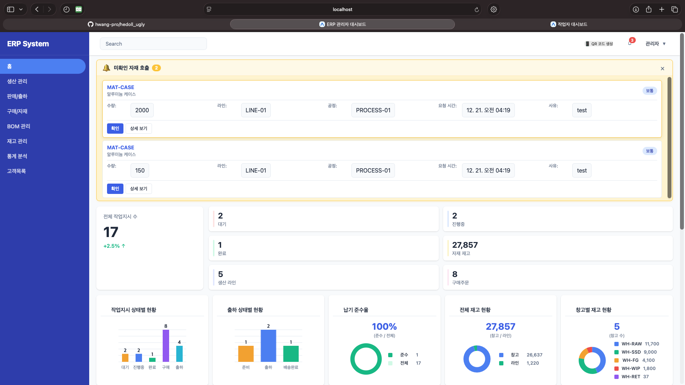

호출 내역을 상태별로 필터링하고 상세 조회·진행 처리를 할 수 있다. 공급 방식에 따라 구매주문이나 생산 흐름으로 연결한다.

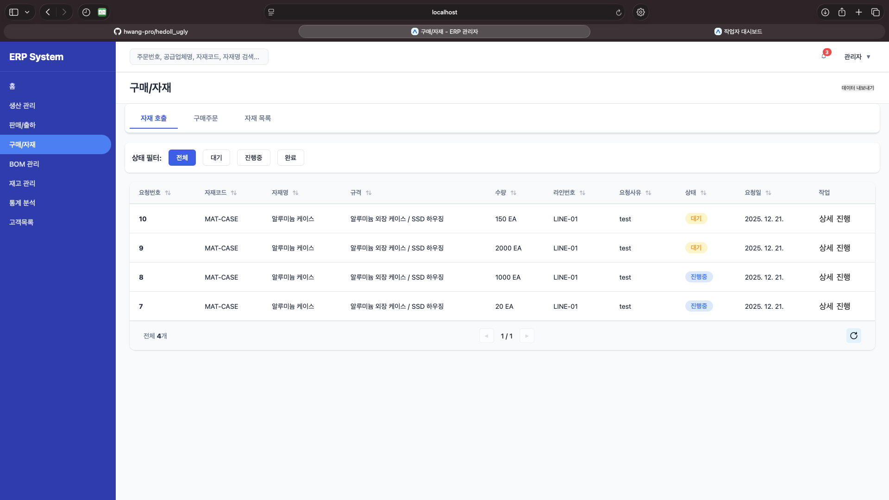

상태는 `pending`, `processing`, `completed`, `cancelled`다. 변경 API에서 상태값을 검사한 뒤 DB를 갱신한다.

| 상태 | 의미 |
| --- | --- |
| pending | 작업자가 요청을 등록했지만 아직 처리 전 |
| processing | 관리자가 확인하고 처리 진행 중 |
| completed | 자재 이동 또는 구매 처리가 완료됨 |
| cancelled | 요청이 취소됨 |

## BOM 및 재고 관리

BOM 화면에 제품별 자재·소요량과 창고·라인·총 재고를 표시했다.

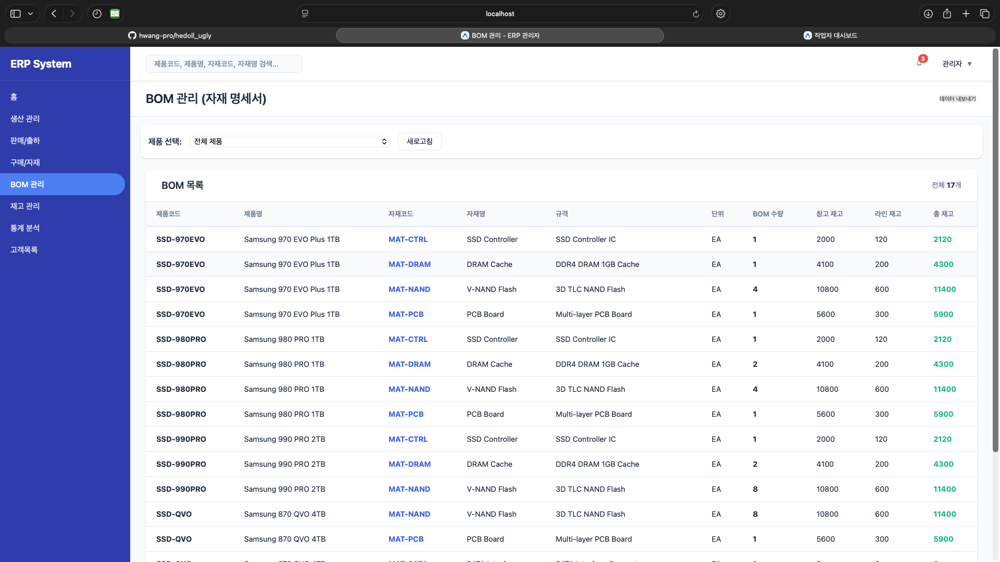

작업지시 수량으로 필요 자재량을 계산하고 창고·라인 재고와 비교했다.

재고는 자재·규격·위치·수량별로 조회한다. 이동 시 위치별 수량을 갱신하고 이력을 남겼다.

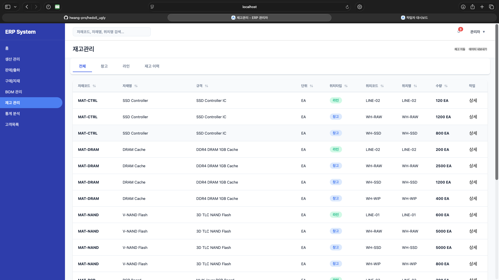

재고 이동은 트랜잭션으로 처리했다. 출발지 재고가 부족하면 거부하고, 충분하면 차감·증가·이력 저장을 함께 실행한다.

## 기능별 처리 구조

| 기능 | 처리 내용 |
| --- | --- |
| 자재 호출 | 작업자가 QR을 스캔한 뒤 자재 코드, 수량, 호출 사유를 입력 |
| 호출 내역 처리 | 관리자가 대기 중인 호출을 확인하고 상세 내용 확인 또는 진행 처리 |
| 작업지시 확인 | 전체 작업지시 수와 대기, 진행, 완료 상태를 대시보드에서 확인 |
| BOM 확인 | 제품별 필요 자재와 소요량을 확인 |
| 재고 확인 | 창고 재고와 라인 재고를 구분해 자재 수량 확인 |
| 통계 분석 | 납기 준수율, 과거 기록, 판매 실적, 창고별 재고 현황 확인 |
| 고객 정보 | 거래처 목록과 세부 정보를 확인 |

## 구현 흐름

칸반 방식의 자재 보충 흐름을 구현했다.

1. 작업자가 현장 QR 코드를 스캔한다.
2. 라인과 공정이 지정된 자재 호출 화면이 열린다.
3. 작업자가 자재 코드, 수량, 사유를 입력해 요청을 등록한다.
4. 요청은 DB에 `pending` 상태로 저장된다.
5. 관리자는 홈 대시보드 또는 구매/자재 화면에서 미확인 요청을 확인한다.
6. 관리자가 상세 내용을 보고 진행 처리하면 상태가 `processing`으로 변경된다.
7. 자재 공급 방식에 따라 구매주문, 재고 이동, 생산 흐름과 연결한다.
8. 처리 결과는 재고, 작업지시, 이력 데이터에 반영된다.

## 실무 ERP와의 차이

실무 ERP와 구현 범위를 비교했다.

| 구분 | 실무 ERP | 이번 프로젝트 |
| --- | --- | --- |
| 데이터 규모 | 수만~수백만 건 이상의 장기간 누적 데이터 | 수십 건 수준의 샘플 기준 정보와 프로젝트 데이터 |
| 프로세스 자동화 | 수주, MRP, 작업지시, 자재소요, 구매, 출하가 자동 연결 | 작업지시, 자재 요청, 구매/출하 흐름을 수동 트리거 중심으로 연결 |
| 권한 관리 | 부서, 직급, 승인 단계별 세밀한 권한 | 관리자와 작업자 중심의 단순 구분 |
| 이력 관리 | 변경 이력, 승인 이력, 회계/감사 추적 필수 | 최신 상태 중심, 일부 거래 이력과 로그 저장 |
| 예외 처리 | 부분 출하, 반품, 긴급 생산, 수량 불일치 등 복잡한 예외 포함 | 정상 흐름 중심으로 구현 |

## 한계점

- 실습·검증용 데이터라 실제 기업의 데이터 규모와 정확성을 검증하지 못했다.

- 회계·세무·내부 통제는 구현 범위에서 제외했다.

- 인증·세부 권한·승인·감사 로그가 충분하지 않다.

- MES·SCM·외주 구매 시스템 연동은 구현하지 않았다.

## 향후 과제

역할별 로그인·권한과 재고 기준 자동 구매주문(MRP)을 추가할 계획이다.

FIFO 차감·자재 추적성을 보강하고, 외부 배포·HTTPS·접근 제어·DB 백업·복구를 검증할 계획이다.

## 회고

QR 요청을 재고·작업지시·BOM에 연결했다.

요청 상태와 위치별 재고를 나눠 모델링하고, 처리 결과를 이력으로 남겼다.
