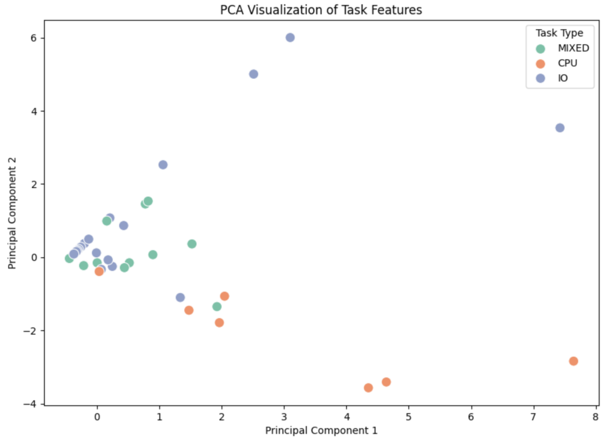
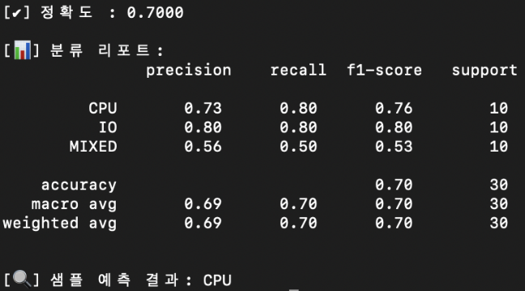
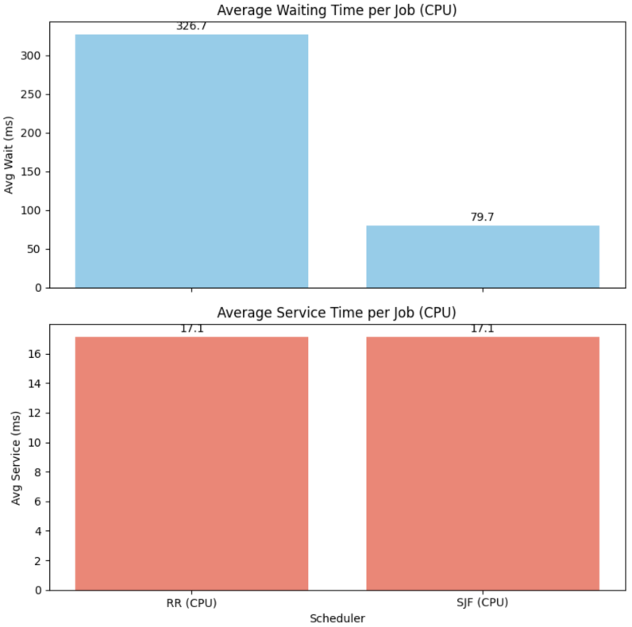
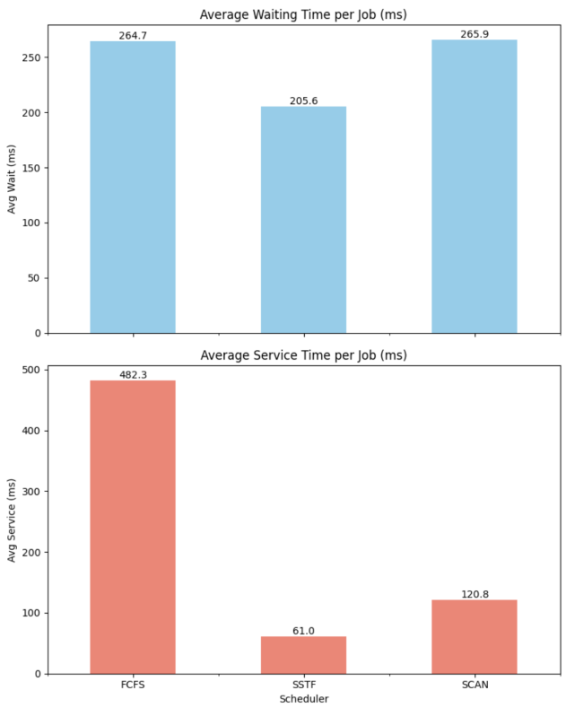

작업 실행 특성을 측정하고 유형별 스케줄링 성능을 비교했다.

## 프로젝트 개요

CPU 연산과 I/O 대기 비중에 따라 스케줄링 결과가 달라지는지 실험했다.

작업 유형을 분류한 뒤 대기 시간·서비스 시간을 비교했다.

## 벤치마크 설계

CPU-bound·I/O-bound·Mixed 작업을 각각 50개씩, 총 150개 만들었다.

| 작업 유형 | 예시 |
| --- | --- |
| CPU-bound | 대량 정수 연산, 정렬, 소수 판별, 해시 계산 |
| I/O-bound | 파일 쓰기/읽기, 텍스트 및 바이너리 입출력, 네트워크 요청, `sleep()` 지연 |
| Mixed | CPU 연산과 I/O 대기가 함께 포함된 작업 |

`psutil`로 실행 전후 CPU 시간·메모리·실행 시간을 측정했다. JSON으로 저장하고 CSV로 통합했다.

```python
def measure(task_func, task_name):
    process = psutil.Process()

    cpu_start = process.cpu_times()
    mem_start = process.memory_info().rss
    time_start = time.time()

    task_func()

    time_end = time.time()
    cpu_end = process.cpu_times()
    mem_end = process.memory_info().rss

    result = {
        "task": task_name,
        "duration_sec": round(time_end - time_start, 4),
        "cpu_user_time": round(cpu_end.user - cpu_start.user, 4),
        "memory_diff_bytes": abs(mem_end - mem_start)
    }
```

CPU-bound 작업은 연산량을 늘려 만들었다.

```python
def cpu_bound_task_v1():
    sum([i**2 for i in range(10**6)])
```

I/O-bound 작업은 파일·네트워크 접근과 대기 시간으로 구성했다.

```python
def io_bound_task_v1():
    import time
    for _ in range(5):
        time.sleep(0.5)
```

## 작업 유형 분류 모델

입력은 `duration_sec`, `cpu_user_time`, `memory_diff_bytes`, 타깃은 작업 유형이다. `MinMaxScaler`로 변환한 뒤 학습·테스트 데이터를 나눴다.

```python
X = df[["duration_sec", "cpu_user_time", "memory_diff_bytes"]]
y = df["label"]

scaler = MinMaxScaler()
X_scaled = scaler.fit_transform(X)

X_train, X_test, y_train, y_test = train_test_split(
    X_scaled,
    y,
    test_size=0.2,
    random_state=42
)
```

랜덤포레스트는 트리 200개, 최대 깊이 5로 설정했다.

```python
clf = RandomForestClassifier(
    n_estimators=200,
    max_depth=5,
    min_samples_split=2,
    random_state=42
)
clf.fit(X_train, y_train)
```

PCA 2차원 시각화에서 유형별 분포 차이는 있었지만 완전히 분리되지는 않았다.



테스트 정확도는 0.70이었다. CPU·IO보다 Mixed 분류가 어려웠다.



| 작업 유형 | Precision | Recall | F1-score |
| --- | --- | --- | --- |
| CPU | 0.73 | 0.80 | 0.76 |
| IO | 0.80 | 0.80 | 0.80 |
| MIXED | 0.56 | 0.50 | 0.53 |
| 전체 정확도 | - | - | 0.70 |

## 스케줄링 알고리즘 비교

CPU-bound는 Round-Robin·SJF, I/O-bound는 FCFS·SSTF·SCAN을 비교했다.

### CPU-bound 작업

| 알고리즘 | 평균 대기 시간 | 평균 서비스 시간 |
| --- | --- | --- |
| Round-Robin | 326.7ms | 17.1ms |
| SJF | 79.7ms | 17.1ms |



SJF의 평균 대기 시간이 짧았다. 서비스 시간은 두 방식이 비슷했다.

SJF는 실행 시간을 미리 알아야 한다. 실제 환경에 적용하려면 실행 시간 추정이 필요하다.

### I/O-bound 작업

| 알고리즘 | 평균 대기 시간 | 평균 서비스 시간 |
| --- | --- | --- |
| FCFS | 264.7ms | 482.3ms |
| SSTF | 205.6ms | 61.0ms |
| SCAN | 265.9ms | 120.8ms |



이번 실험에서는 SSTF의 대기·서비스 시간이 가장 짧았다. SCAN은 FCFS보다 서비스 시간이 짧았다.

## 결과 정리

* CPU-bound: SJF의 평균 대기 시간이 Round-Robin보다 짧았다.
* I/O-bound: SSTF의 평균 서비스 시간이 가장 짧았다.
* 분류: CPU·IO는 비교적 잘 구분했지만 Mixed는 어려웠다.

## 한계점

- 합성 벤치마크 150개로 실제 운영체제의 모든 작업을 대표하지 못한다.

- 입력 특성이 3개뿐이다. 문맥 전환·디스크 I/O·네트워크 대기·캐시 영향은 반영하지 않았다.

- SJF·SSTF는 특정 작업이 오래 기다리는 기아(starvation)가 발생할 수 있다.

- Mixed 작업의 분류 성능이 낮았다.

## 향후 과제

MLFQ·Mixed 전용 스케줄러와 XGBoost·SVM·신경망을 추가 비교할 계획이다.

`GridSearchCV`·`RandomizedSearchCV`로 하이퍼파라미터를 조정할 계획이다.

## 회고

작업 데이터를 직접 만들고 측정해 스케줄링 결과를 비교했다.
