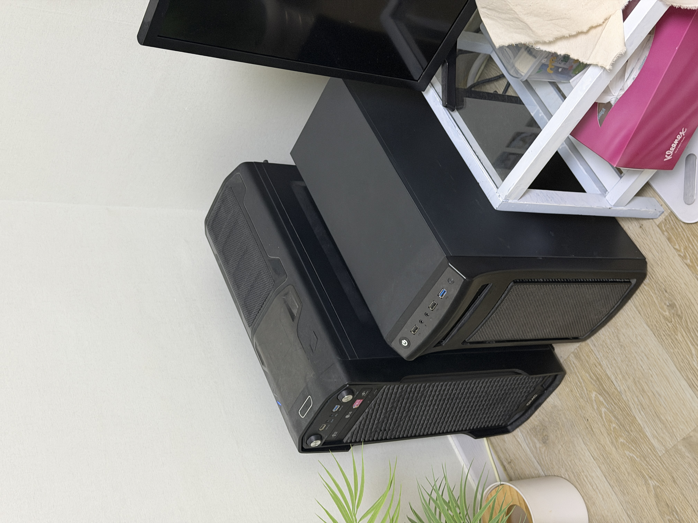
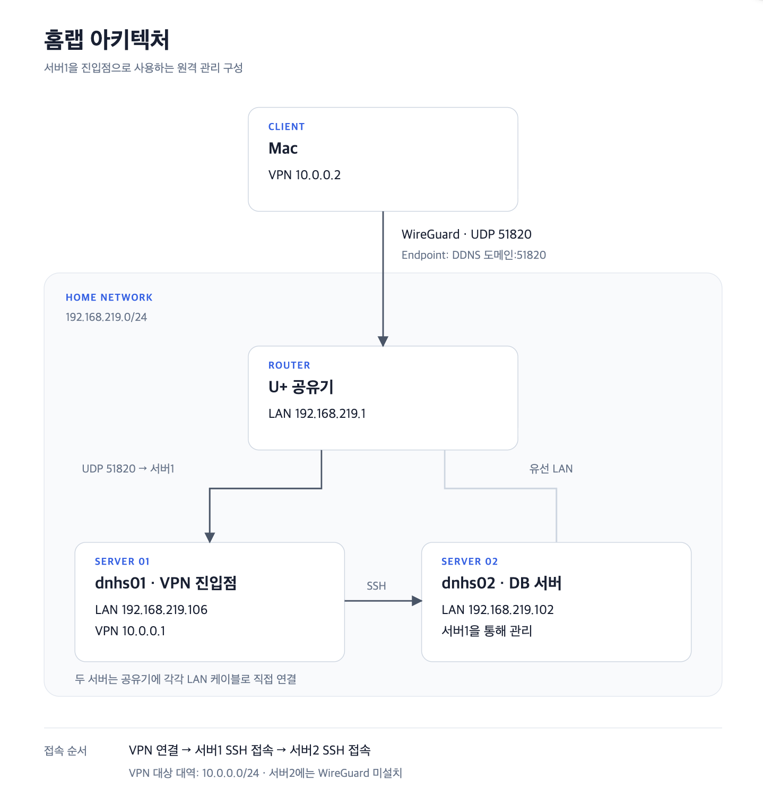

## 홈서버를 만들게 된 배경

집에서 좀 더 다양한 것을 해보고 싶었다. 복수전공을 하면서 어려움도 많았고, 학업 프로젝트만으로 실력과 경험을 쌓기에는 부족하다는 생각이 들었다.

그러던 중 친하게 지내던 선배가 쓰던 서버 컴퓨터 두 대를 가져가서 써보겠냐고 물었다. 냉큼 받아 와서 무엇을 할 수 있을지 생각해 봤다.

막상 받아 보니 성능은 생각보다 낮았다. CPU도 구형이었고 딥러닝에 활용할 만한 그래픽카드도 없었다. 대신 제한된 장비로 직접 서버를 구성하고 관리해 보기로 했다. 처음에는 배포할 프로젝트가 없어 서버와 네트워크 구성부터 시작했다.

## 서버 사양

<figure class="project-figure">
  
  <figcaption>홈랩에 사용하는 PC 두 대.</figcaption>
</figure>

| 항목 | 서버1 · dnhs01 | 서버2 · dnhs02 |
| --- | --- | --- |
| CPU | Intel Core i3-4150 · 3.50GHz | Intel Core i3-6100 · 3.70GHz |
| 코어·스레드 | 2코어 4스레드 | 2코어 4스레드 |
| 메모리 | 약 8GB | 약 8GB |
| 저장장치 | WD HDD 1TB | SanDisk SSD 120GB + WD HDD 1TB |
| 운영체제 | Ubuntu Desktop 22.04.5 LTS | Ubuntu Desktop 22.04.5 LTS |
| 내부 IP | `192.168.219.106` | `192.168.219.102` |
| 초기 역할 | 서비스 실행·원격 관리 진입점 | 데이터베이스·데이터 저장 |

서버1은 HDD에 운영체제와 파일을 함께 보관한다. WireGuard를 실행해 원격 관리 접점으로 사용한다.

서버2는 SSD에 운영체제를 설치하고 HDD를 `/data`에 연결했다. 서버1에서 공개키 인증으로 SSH 접속한다.

초기에는 서버2를 데이터베이스 전용으로 구성했다. 관리 진입점을 한곳에 모으기 위해 WireGuard는 서버1에만 설치하고 서버2는 서버1을 거쳐 관리하도록 했다.

## Ubuntu Desktop을 선택한 이유

컴퓨터를 받았을 때는 Windows와 이름이 기억나지 않는 다른 운영체제가 설치돼 있었다. 두 서버 모두 Ubuntu로 다시 설치했고, 처음에는 당시 최신 버전을 사용했다.

이후 진행할 프로젝트에서 SQL Server를 요구했다. 당시 사용하려던 SQL Server의 지원 환경에 맞춰 Ubuntu 22.04 LTS 계열로 다시 설치했다. 현재 버전은 Ubuntu 22.04.5 LTS다.

처음에는 Ubuntu Server를 고려했다. 다만 서버 구성이 처음이었고 학습 목적도 있어 GUI를 함께 쓸 수 있는 Desktop을 선택했다.

## 집 인터넷과의 연결

집주인이 마련한 기존 회선을 사용했다. 가입 속도와 공유기의 정확한 모델명은 확인하지 않았다. U+ 공유기에 두 서버를 LAN 케이블로 직접 연결했고, 별도 허브는 사용하지 않았다.

두 서버는 같은 내부망에 있고 기본 게이트웨이는 `192.168.219.1`이다. 운영체제에서는 DHCP로 주소를 받는다. 공유기의 DHCP 주소 예약 여부는 아직 확인하지 않았다.

서버 간 통신과 서버1에서 서버2로의 SSH 접속은 내부 IP를 사용한다.

외부 VPN 접속을 위해 공유기에 UDP 51820 포트포워딩을 설정했다. 해당 포트로 들어오는 통신을 WireGuard가 실행되는 서버1로 전달한다.

<figure class="project-figure">
  
  <figcaption>서버1을 진입점으로 사용하는 원격 관리 구성.</figcaption>
</figure>

## WireGuard로 원격 접속 구성

서버1의 VPN 인터페이스 `wg0`에 `10.0.0.1/24`를 설정했다. `wg-quick@wg0` 서비스로 실행한다.

관리용 컴퓨터는 Mac이다. Mac에서 WireGuard로 서버1에 연결한 뒤 SSH로 접속한다. 서버2는 서버1에서 내부 IP로 SSH 접속한다.

Mac의 설정은 다음과 같다. 키와 실제 접속 도메인은 생략했다. 아래 값은 구성 설명용이다.

```ini
[Interface]
PrivateKey = <클라이언트 개인키>
Address = 10.0.0.2/24
DNS = 1.1.1.1

[Peer]
PublicKey = <서버1의 공개키>
AllowedIPs = 10.0.0.0/24
Endpoint = <DDNS 도메인>:51820
PersistentKeepalive = 25
```

| 설정 | 역할 |
| --- | --- |
| `Address` | Mac의 VPN 주소 |
| `DNS` | 클라이언트 설정에 지정한 DNS 서버 |
| `Endpoint` | 접속할 DDNS 도메인과 UDP 포트 |
| `AllowedIPs` | VPN으로 보낼 목적지 범위 |
| `PersistentKeepalive = 25` | NAT 연결 유지를 위한 25초 간격 패킷 전송 |

`AllowedIPs`는 `10.0.0.0/24`만 포함한다. Mac의 모든 인터넷 트래픽을 VPN으로 보내지는 않는다. 서버2의 내부 IP도 이 범위에 없으므로 서버1에 SSH 접속한 다음 내부망으로 접근한다.

## 처음이라 어려웠던 점

처음에는 무엇을 설정해야 하는지부터 막혔다. Docker의 컨테이너·호스트 관계와 포트 연결 방식도 낯설었다.

특히 WireGuard 핸드셰이크가 되는데도 원하는 곳에 접속되지 않는 상황이 혼란스러웠다. 공부하면서 핸드셰이크 성공과 실제 통신 경로 확보는 별개라는 점을 알게 됐다.

당시 부팅 후 WireGuard 자동 실행 설정도 빠뜨렸던 것으로 기억한다. 이것만으로 접속 문제를 설명할 수는 없지만, 수동 실행과 재부팅 후 사용은 따로 확인해야 했다. 현재는 서버1에서 `wg-quick@wg0` 서비스를 사용한다.

중간에 집주인이 바뀌면서 통신사도 U+로 변경됐다. 공유기 설정 범위가 이전보다 제한적으로 느껴졌고, 기존 IP 설정도 다시 맞춰야 했다.

이전에는 별도 도메인 없이 접속했지만 인터넷 환경이 바뀐 뒤 기존 방식으로 접속할 수 없었다. 무료 DDNS 도메인을 받고 WireGuard의 Endpoint를 변경했다. 정확한 원인은 기억이 분명하지 않다. 이때 접속 주소·포트포워딩·서버 내부 IP를 다시 확인했다.

접속 문제를 이해하려고 밤을 새우며 Docker와 네트워크 개념을 찾아봤다. 설정을 따라 하는 것보다 각 설정의 역할을 이해하는 데 시간이 더 걸렸다.

## 현재 상태와 다음 작업

현재는 원격 접속과 서버 운영이 원활하다. 노후 장비의 팬에 먼지가 쌓인 상태에서 전원이 켜지지 않은 적은 있었지만, 현재 소프트웨어·설정 문제는 겪지 않고 있다.

1월 중순 본가로 이사하면 네트워크가 바뀐다. 새 환경에서 내부 IP·포트포워딩·DDNS·VPN 접속을 다시 확인할 계획이다.
