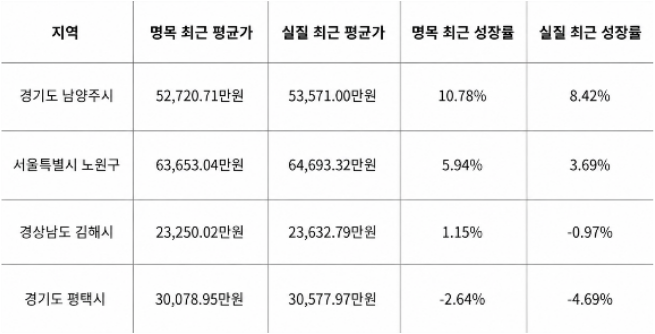
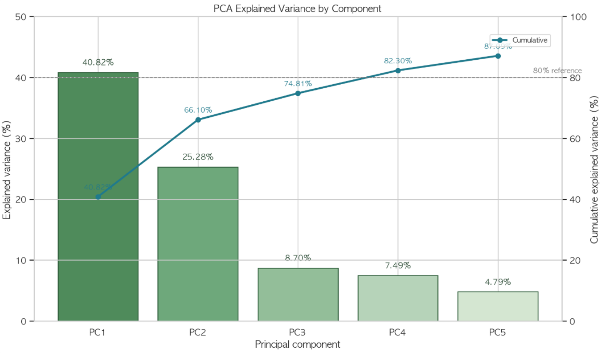
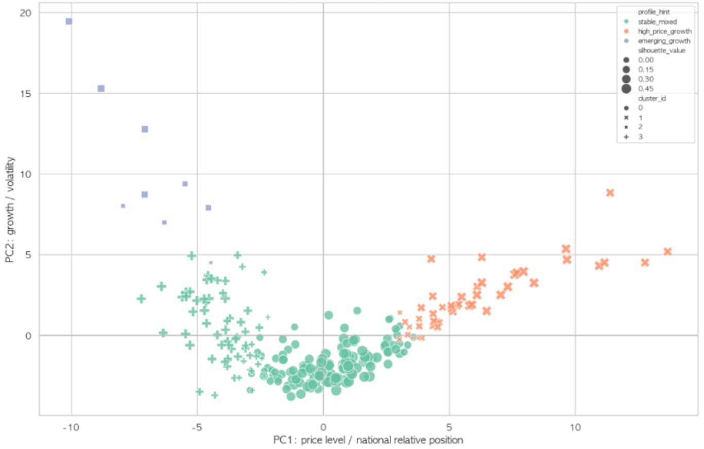
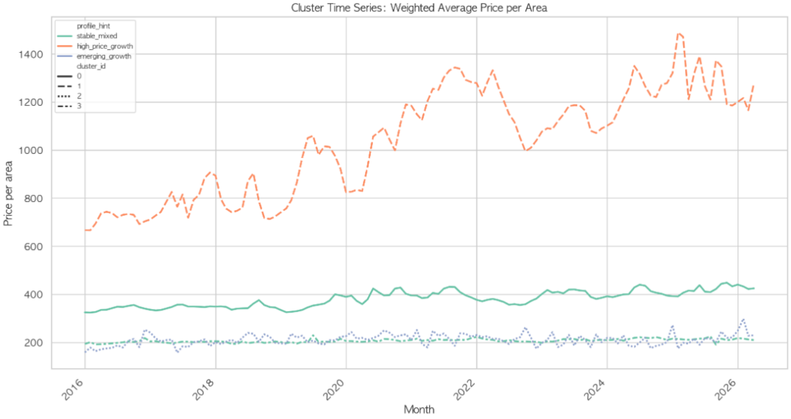
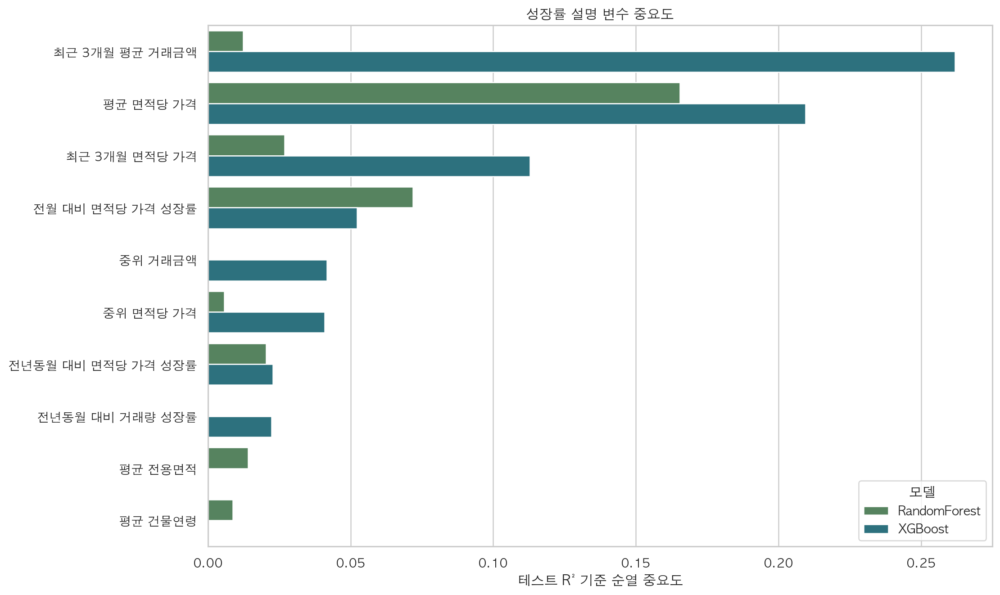
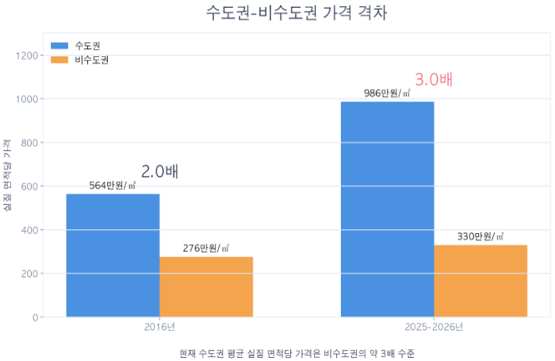
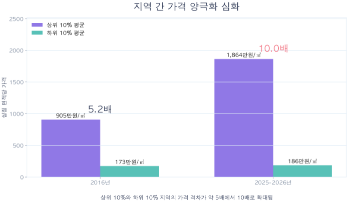
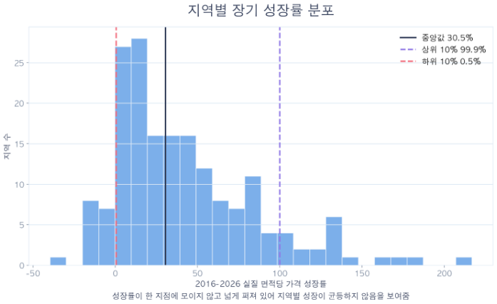
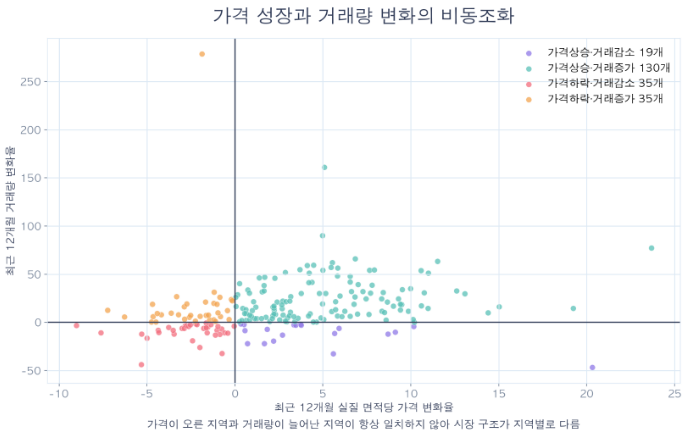

전국 아파트 실거래 데이터로 지역별 성장 유형과 가격 격차를 분석.

## 프로젝트 개요

지역 간 가격 격차, 성장 유형, 가격·거래량 변화를 비교했다.

분석 범위는 다음과 같다.

* 2016년 이후 실질 가격 격차.
* 수도권·비수도권 격차.
* 가격·성장률·거래량·신축 비율에 따른 지역 유형.
* 성장률과 관련된 주요 변수.
* 성장·정체 지역의 차이와 외부 근거.

## 데이터 구성

국토교통부의 2016년~2026년 4월 전국 아파트 매매 데이터 약 530만 건을 사용했다. 지도에는 국토교통부·VWorld 행정구역 경계를 사용했다.

| 구분 | 내용 |
| --- | --- |
| 원천 데이터 | 국토교통부 실거래가 공개시스템 |
| 분석 대상 | 전국 아파트 매매 거래 |
| 분석 기간 | 2016년 1월 ~ 2026년 4월 |
| 데이터 규모 | 약 530만 row |
| 주요 변수 | 거래금액, 전용면적, 층수, 건축년도, 거래일, 법정동, 시군구 |
| 추가 데이터 | 행정구역 경계 데이터 |

거래량이 많고 지역 간 비교가 가능한 아파트 매매로 범위를 정했다.

## 데이터 저장 및 집계

원본은 PostgreSQL 기반 Neon DB에 저장했다. 분석용 컬럼을 정리하고 시군구·월 단위로 집계했다.

약 530만 건을 `시군구 × 월` 단위 약 3만 행으로 줄였다.

| 집계 단위 | 생성한 주요 feature |
| --- | --- |
| 가격 수준 | 평균 거래금액, 중앙값 거래금액, 평균 면적당 가격, 전국 대비 가격 |
| 거래량 | 월별 거래량, 최근 3개월 거래량, 최근 12개월 거래량 |
| 성장률 | 전월 대비 성장률, 전년동월 대비 성장률, 최근 12개월 성장률 |
| 주택 특성 | 평균 전용면적, 평균 건물연령, 신축 비율 |
| 지역 비교 | 수도권 여부, 전국 평균 대비 상대 가격 |

지역별 장기 비교를 위해 집계했다. 개별 거래의 세부 차이는 줄어든다.

## CPI 보정

10년간 물가 변화를 반영하기 위해 CPI로 보정했다.

통계청 CPI로 거래금액을 2026년 4월 가치로 환산했다. 장기 성장률·격차는 실질 면적당 가격을 중심으로 비교했다.

일부 지역은 명목 성장률과 실질 성장률이 달랐다.

## 탐색적 데이터 분석

거래금액은 최소 약 400만 원, 최대 약 290억 원, 평균 약 3.7억 원이었다. 면적·층수·건축년도·지역별 거래량도 확인했다.

거래는 1억~5억 원, 55~85㎡에 집중됐다. 59㎡·84㎡ 부근의 거래가 많았고 일부 초고가 거래가 있었다.

면적과 거래금액의 상관관계가 가장 컸다. 같은 면적에서도 가격 분포가 넓어 면적만으로 설명하기는 어려웠다.

## 이상거래 탐지

특수거래일 수 있어 가격만으로 이상치를 삭제하지 않았다.

Isolation Forest와 규칙 검토를 병행했다. 같은 월·시군구에서 벗어난 가격을 찾고, 동일 단지·유사 면적·전후 기간 거래와 비교했다.

| 단계 | 내용 | 결과 |
| --- | --- | --- |
| 1차 탐지 | 같은 월, 같은 시군구 내 가격/면적당 가격 이상치 탐지 | 517건 |
| 2차 검토 | 동일 단지, 유사 면적, 전후 기간 거래와 비교 | 검사 필요 6건 |
| 최종 판단 | 제거 전후 집계 평균/중앙값 변화 확인 | 영향이 작아 분석에 포함 |

검사 대상 6건은 남겼다. 집계 영향이 작았고 실제 특수거래일 가능성이 있었다.

## PCA 기반 지역 구조 분석

가격·최근 성장률·거래량·신축 비율·건물연령·전국 대비 가격을 특성으로 만들었다.

`StandardScaler`로 표준화하고 PCA로 축약했다. 시각화와 KMeans 입력에 사용했다.

PC1은 가격 수준·전국 대비 고가성, PC2는 성장률·변동성 축으로 해석했다.

| 주성분 | 해석 |
| --- | --- |
| PC1 | 가격 수준, 전국 대비 상대 가격 |
| PC2 | 성장률과 변동성 |
| PC3 | 노후도와 신축 대비 |
| PC4 | 최근 성장 전환 |
| PC5 | 거래량 변화 |

설명 분산은 PC1 40.82%, PC1~2 66.10%, PC1~5 87.09%였다.

## KMeans 군집화

250개가 넘는 시군구를 성장 유형별로 묶었다.

PCA 좌표로 KMeans를 적용했다. 해석 가능성을 고려해 `k=4`로 정했다.

| 군집 유형 | 해석 |
| --- | --- |
| 고가 성장형 | 이미 가격 수준이 높고, 성장률도 높은 지역 |
| 신흥 성장형 | 가격 수준은 낮지만 최근 성장률과 변동성이 큰 지역 |
| 안정 혼합형 | 가격과 성장률이 중간 수준에서 비교적 안정적인 지역 |
| 저성장/정체형 | 가격 수준과 성장률이 모두 낮은 지역 |

고가 성장형의 실질 면적당 가격은 다른 군집과 격차가 벌어지는 경향을 보였다.

일부 지역은 낮은 가격·성장률에 머물렀다.

## RandomForest와 XGBoost

RandomForest·XGBoost로 향후 12개월 실질 면적당 가격 성장률과 관련된 변수를 확인했다.

| 구분 | 내용 |
| --- | --- |
| 예측 대상 | 향후 12개월 실질 면적당 가격 성장률 |
| 분석 단위 | 시군구 x 월 |
| 데이터 수 | 27,953 rows |
| Feature 수 | 19개 |
| Train/Test | 21,974 / 5,979 |
| 비교 모델 | RandomForest, XGBoost |

두 모델에서 거래량보다 현재 가격·최근 가격 흐름·단기 거래금액 변화의 중요도가 높았다.

| 모델 | 주요 변수 |
| --- | --- |
| RandomForest | 면적당 가격, 전월 가격 성장률, 최근 3개월 가격, 전년동월 가격 성장률, 평균 전용면적 |
| XGBoost | 최근 3개월 거래금액, 면적당 가격, 최근 3개월 면적당 가격, 전월 가격 성장률, 중앙값 거래금액 |

R²는 RandomForest 0.294, XGBoost 0.278로 낮았다. 실거래 특성만으로 성장률을 충분히 설명하지 못했다.

모델은 변수 탐색에만 사용했다.

## 지역 양극화 분석

상위·하위 10% 지역의 실질 면적당 가격 격차는 2016년 약 5.2배에서 2025~2026년 약 10배로 커졌다.

수도권·비수도권 격차는 2016년 약 2배에서 2025~2026년 약 3배로 커졌다.

대부분은 중간 성장 구간에 모였다. 일부는 100% 이상 성장했고 일부는 거의 성장하지 않았다.

가격·거래량이 함께 늘어난 지역이 가장 많았다. 두 지표가 반대로 움직인 지역도 있었다.

시장 활성화를 판단하려면 가격 외에 거래량·신축 비율·인구·산업·개발 계획도 확인해야 한다.

## RAG 기반 원인 해석

급등·급락 지역과 시기를 추출하고 뉴스·정책·지자체 자료로 원인 후보를 요약하는 RAG 구조를 설계했다.

입력은 지역명·기간·장기 성장률·급등락 시기·거래량 변화·실질 면적당 가격·최근 12개월 성장률·전국 대비 가격·군집·모델 주요 변수다.

| 패턴 | 주요 해석 |
| --- | --- |
| 고가 지역 집중 성장 | 재개발, 재건축, 신축 대단지, 교통망 개선, 서울/수도권 선호 집중 |
| 신흥 성장 지역 | 낮은 기저 가격, 특정 개발 사업, 신축 공급, 교통 접근성 개선 |
| 가격과 거래량 비동조화 | 가격 상승이 항상 거래량 증가를 의미하지 않음 |
| 후퇴/정체 지역 | 산업 침체, 인구 감소, 수요 기반 약화, 미분양 및 공급 부담 |

RAG는 원인 후보를 제시한다. 통계적 인과관계를 증명하지는 못한다.

## 웹 시각화

웹 대시보드에 전국 히트맵·지역 시계열·군집·상하위 성장 지역·RAG 해석을 표시했다.

## 결과 정리

* 상위 10%와 하위 10% 지역의 실질 면적당 가격 격차가 약 5.2배에서 약 10배로 확대되었다.
* 수도권과 비수도권의 가격 격차도 약 2배에서 약 3배 수준으로 커졌다.
* PCA로 가격·성장률·노후도·성장 전환·거래량 축을 요약했다.
* KMeans로 고가 성장형·신흥 성장형·안정 혼합형·저성장/정체형을 구분했다.
* 모델에서는 현재 가격과 최근 흐름의 중요도가 높았다.
* 가격과 거래량 변화가 항상 일치하지 않았다.

## 한계점

- 예측 성능이 낮았다. 정책·금리·입지·개발·산업·인구 등 외부 요인을 반영하지 못했다.

- 실거래에 없는 매물·호가·미분양·소득·교통 정보는 별도로 결합해야 한다.

- 시군구 집계는 단지·동별 차이를 줄이므로 개별 아파트 가격 예측에 적합하지 않다.

- RAG 해석을 정책 제안 등에 사용하려면 추가 검증이 필요하다.

## 향후 과제

금리·인구·미분양·공급·교통·기업 입주 정보를 추가하고, 시계열·패널·공간 회귀 모델을 비교할 계획이다.

RAG 근거 문서를 관리하고 공식자료·기사별 신뢰도를 구분할 계획이다.

## 회고

실거래 특성만으로는 가격 변화를 충분히 설명하지 못했다.

예측 성능이 낮아 분석 중심으로 방향을 바꿨다. 발표에서는 성능의 한계와 전환 이유를 충분히 설명하지 못했다.

전국 거래를 정리하고 성장 유형·가격 격차를 분석했다.
