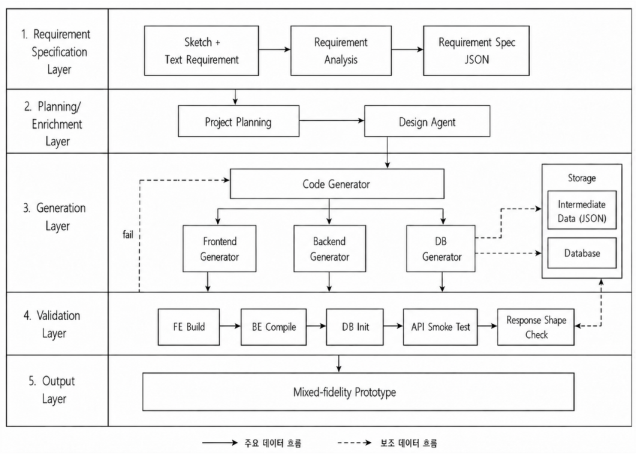
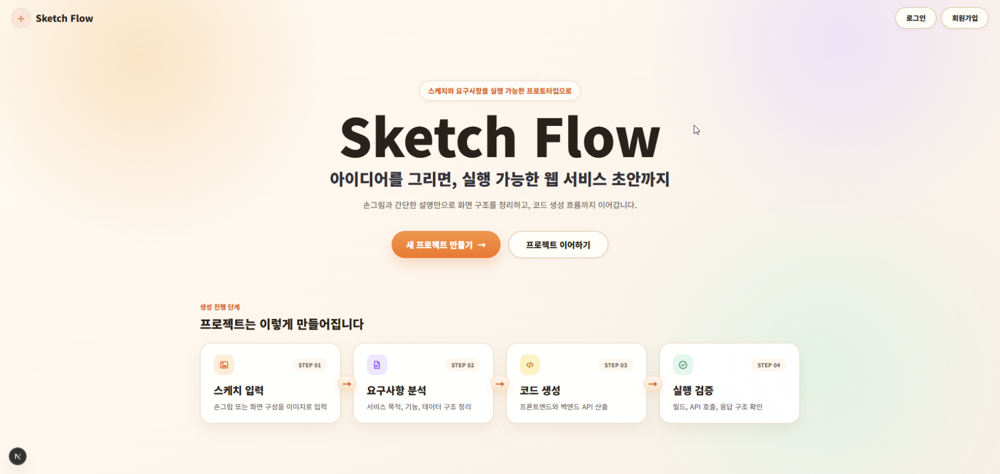
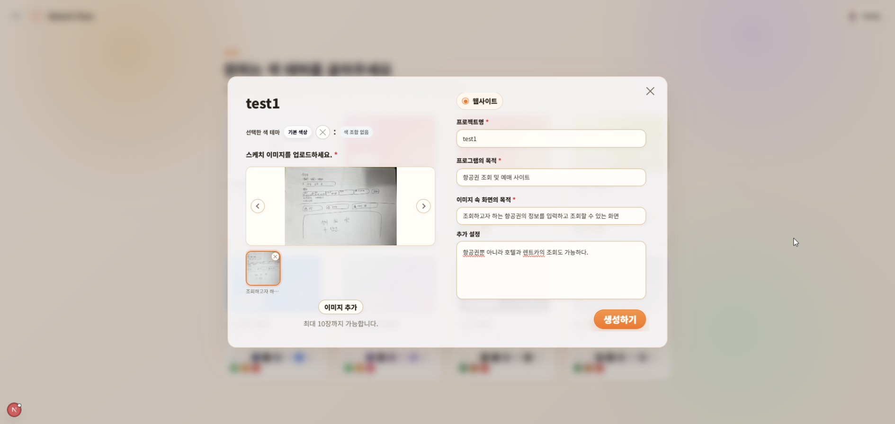
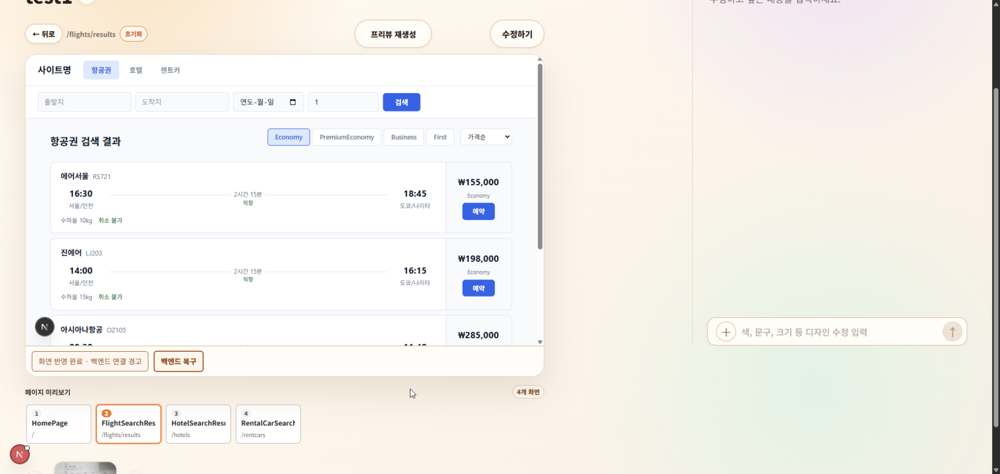
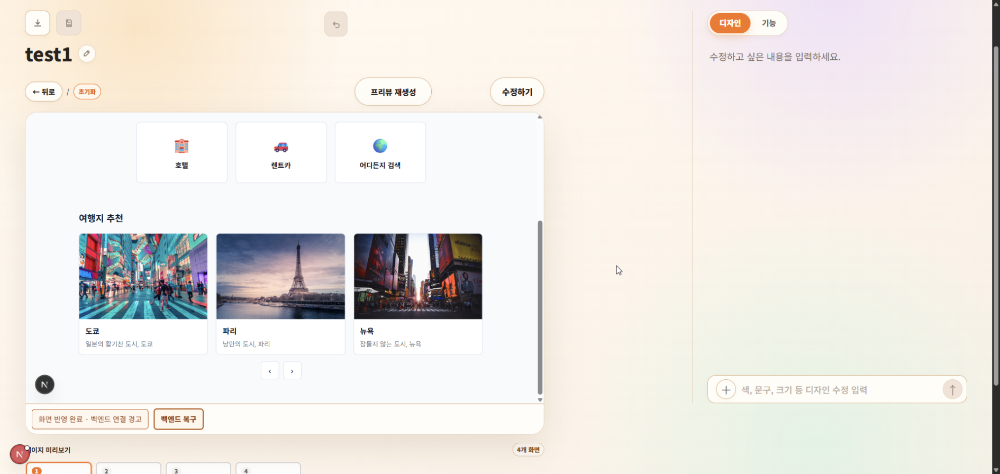
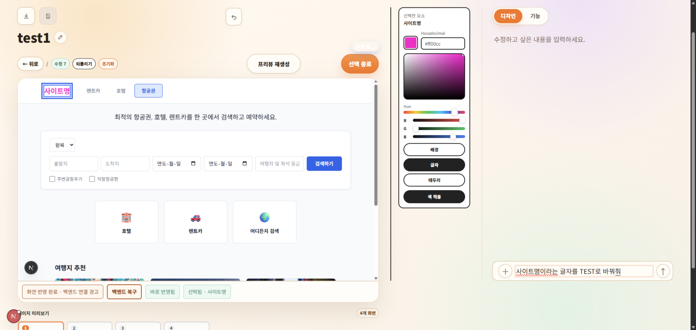
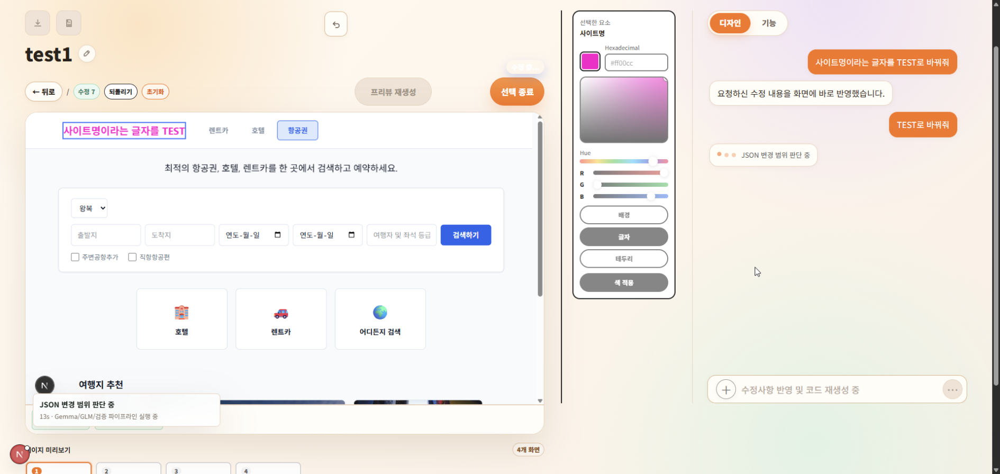

스케치와 요구사항을 기반으로 LLM을 기반으로 실행 가능한 동적 웹 프로토타입을 생성하는 캡스톤 프로젝트.

## 프로젝트 개요

UI 스케치와 자연어 요구사항을 입력받는 `Sketch Flow`를 개발했다.

기획자·디자이너·개발 입문자를 대상으로 했다. 화면·기능·데이터·API 명세를 정리하고 프론트엔드·백엔드 초안을 생성한다.

목표는 `Mixed-fidelity` 동적 프로토타입이다. 화면 이동·입력·API·간단한 DB 흐름을 브라우저에서 검증하는 수준으로 범위를 정했다.

| 구분 | 내용 |
| --- | --- |
| 프로젝트명 | Sketch Flow |
| 주제 | UI Sketch를 활용한 LLM 기반 동적 소프트웨어 프로토타입 생성 시스템 |
| 기간 | 2026년 3월 ~ 2026년 6월 |
| 팀명 | 우김구김 |
| 팀원 | 구현주, 김동귀, 김효원, 우희석 |
| 핵심 산출물 | Sketch Flow 웹서비스, 생성 파이프라인, 라이브 프리뷰, 채팅 수정, 검증/복구 흐름 |

## 문제 배경

아이디어는 있지만 웹을 개발해본적이 없어서 개발하지 못하는 비전공자, 외주 금액이 비싸서 스스로 해야하는 사용자, 웹의 생성부터 배포까지 빠르게 학습하고 싶은 학생, 빠른 시일내에 배포가 완료되어야하는 사용자까지 본인의 스케치로 쉽게 웹을 생성해주는 시스템을 만드는 것을 목표로 한다. 

하지만 손그림과 와이어프레임만으로는 화면 이동·입력 흐름을 시험하기 어렵다.
따라서 스케치의 화면 구상과 텍스트 요구사항을 함께 입력받도록 했다.

이를 실행 가능한 웹 프로토타입으로 변환했다.

## 핵심 아이디어

코드를 바로 생성하면 화면·데이터·API·사용자 액션의 연결이 어긋날 수 있다.

중간 명세인 `App Spec JSON`을 만들었다. 프론트엔드·백엔드·DB·프리뷰 생성기가 같은 명세를 참조한다.

```json
{
  "project": {
    "name": "travel booking prototype",
    "type": "website"
  },
  "pages": [
    {
      "id": "home",
      "route": "/",
      "purpose": "항공권, 호텔, 렌터카 검색 진입 화면",
      "components": ["tabs", "searchForm", "recommendationCards"]
    }
  ],
  "entities": ["flight", "hotel", "rentcar", "booking"],
  "apis": [
    { "method": "GET", "path": "/flights/search" },
    { "method": "POST", "path": "/bookings" }
  ]
}
```

App Spec에 화면·목적·컴포넌트·액션·라우팅·엔티티·API를 담았다. 생성·수정·검증·복구의 기준으로 사용했다.

## 시스템 아키텍처



명세화·계획·생성·검증·출력 계층으로 나눴다.

| 계층 | 역할 |
| --- | --- |
| 요구사항 명세화 | Sketch와 텍스트 요구사항을 App Spec JSON으로 변환 |
| 계획 및 보강 | 필요한 화면, 데이터 구조, API 범위, 디자인 방향 결정 |
| 생성 | 프론트엔드, 백엔드, DB 산출물 생성 |
| 검증 | FE Build, BE Compile, DB Init, API Smoke Test, Response Shape Check |
| 출력 | 라이브 프리뷰로 Mixed-fidelity Prototype 제공 |

검증 실패 정보는 생성 계층에 전달해 보정·재생성한다.

## 기술 스택

Sketch Flow 서비스와 생성된 프로젝트의 실행 환경을 분리했다.

| 구분 | 기술 | 역할 |
| --- | --- | --- |
| 서비스 프론트엔드 | Next.js, React | 프로젝트 생성, Editor, 프리뷰, 프로젝트 관리 화면 |
| 스타일 | CSS, Tailwind CSS, PostCSS | 서비스 UI와 생성 프론트엔드 스타일 |
| API 서버 | Node.js, Express | 프로젝트 API, 파일 업로드, 생성 파이프라인 제어 |
| 파일 업로드 | Multer | 스케치 이미지와 채팅 이미지 수신 |
| 명세 검증 | AJV, JSON Schema | App Spec 구조 및 자료형 검증 |
| 생성 에이전트 | Python | 계획, 디자인, 프론트엔드·백엔드 생성 |
| 생성 프론트엔드 | Next.js, React | 자동 생성 프로토타입 화면 |
| 생성 백엔드 | FastAPI, Uvicorn, Pydantic | 자동 생성 API 서버 |
| 생성 DB | SQLite | 프로토타입용 데이터 저장 |
| 사용자 인증 | Supabase Auth | 로그인, 세션, 사용자 식별 |
| 스케치 분석 | Gemma 계열 멀티모달 모델 | UI Sketch 분석과 App Spec 생성 |
| 코드 생성 | GLM 계열 모델 | 프론트엔드 페이지와 백엔드 라우터 생성 |
| 오케스트레이션 | Claude 계열 모델 | 생성·수정 범위와 품질 작업 지시 |
| 수정 의도 분류 | OpenAI 모델 | 채팅 요청의 처리 경로 분류 |

모델명·API 주소는 환경변수로 분리했다. 외부 호출 실패 시 가능한 범위에서 로컬 Fallback 생성기를 사용한다.

## 데이터 관점에서의 설계

스케치·자연어를 `App Spec JSON`으로 구조화했다.

같은 명세를 생성기와 검증 로직에서 공유했다.

| 데이터 관점 | 구현 내용 |
| --- | --- |
| 비정형 데이터 처리 | UI Sketch 이미지와 자연어 요구사항 입력 |
| 구조화 데이터 생성 | App Spec JSON으로 화면, 컴포넌트, API, entity 정리 |
| 스키마 설계 | JSON Schema 기반 App Spec 구조 정의 |
| 데이터 검증 | AJV로 필수 필드, 자료형, 참조 관계 검증 |
| 데이터 품질 관리 | 누락된 페이지, 잘못된 API 참조, 불완전한 entity 정규화 |
| 버전 관리 | App Spec v1, v2, current 구조로 수정 이력 저장 |
| 파이프라인 기준 데이터 | FE/BE/DB 생성기가 동일한 App Spec 참조 |
| 결과 검증 | API 구현률, DB CRUD 검증, App Spec과 생성 코드의 구조 비교 |

JSON Schema·AJV로 필수 필드·자료형·식별자·참조를 검증했다. API 경로와 데이터 구조의 불일치를 생성 전에 줄이기 위한 처리다.

## 생성 파이프라인

1. 사용자가 프로젝트명, 서비스 목적, 색상 테마, 스케치 이미지, 이미지별 설명을 입력한다.
2. Gemma 기반 분석기가 스케치 이미지와 텍스트 요구사항에서 화면 구조와 시각적 증거를 추출한다.
3. 추출 결과를 App Spec JSON으로 구성하고 JSON Schema로 검증한다.
4. 생성 계획기가 프론트엔드, 백엔드, DB 생성 범위를 결정한다.
5. GLM 기반 프론트엔드 생성기가 페이지별 JSX와 CSS를 생성한다.
6. GLM 기반 백엔드 생성기가 FastAPI 라우터와 SQLite 스키마를 생성한다.
7. 빌드, 컴파일, DB 초기화, API Smoke Test, 응답 구조 검사를 수행한다.
8. 검증을 통과한 결과를 라이브 프리뷰로 실행한다.
9. 사용자는 프리뷰에서 결과를 확인하고 채팅 또는 요소 선택으로 수정한다.

프로젝트별로 메타데이터·채팅·수정 이력·App Spec 버전·생성 코드·런타임 정보를 저장했다. 재진입과 복구에 사용한다.

## 주요 화면

홈에서 스케치 입력·요구사항 분석·코드 생성·실행 검증 순서를 안내한다.



생성 화면에서 테마·스케치·프로젝트명·목적·요구사항을 입력한다. 여러 스케치를 구분하도록 이미지별 목적도 받는다.



Editor에서 라이브 프리뷰를 실행한다. 화면 이동·입력을 확인하고 페이지 미리보기로 탐색한다.



요소를 선택해 색상·글자·테두리를 수정한다. 단순 변경은 로컬 패치로 처리해 기존 화면을 유지한다.



첨부 이미지를 새 화면·기존 화면 수정·스타일 참고로 구분한다.



수정 요청은 로컬 패치·App Spec 수정·부분 재생성·전체 재생성으로 나눈다. 문구는 즉시 수정하고, 새 페이지·데이터 구조 변경은 명세를 갱신한 뒤 재생성한다.



## 담당 역할

`App Spec·코드 생성·오케스트레이션`을 담당했다.

| 담당 영역 | 수행 내용 |
| --- | --- |
| App Spec 구조 | JSON 기반 명세 구조 설계, 페이지·라우트·엔티티·API 연결 기준 정리 |
| 데이터 품질 관리 | App Spec 검증, 정규화, 버전 저장, 잘못된 참조와 누락 필드 보정 |
| FastAPI 생성기 | JSON 명세 기반 FastAPI 라우터와 SQLite 구조 생성 흐름 구현 |
| FE/BE 생성 에이전트 | 프론트엔드·백엔드 생성 단위 분리, 생성 컨텍스트 구성 |
| 생성 파이프라인 통합 | 스케치 분석, App Spec, 코드 생성, 프리뷰 실행 흐름 연결 |
| 오케스트레이션 | 생성 범위 판단, 수정 요청 분류, 부분 재생성 흐름 보강 |
| 프리뷰 편집 | 요소 선택, 로컬 스타일 패치, 수정 이력 저장 및 재적용 |
| 검증 및 복구 | 빌드 검사, 프리뷰 상태 관리, 실패 복구, 이전 안정 프리뷰 보호 |
| 최종 시연 안정화 | 이미지 수정, 색상 테마 반영, 다운로드 전 검증, 시연 오류 수정 |

수정 요청 때 기존 결과까지 바뀌는 문제가 있었다. 문구·색상·이미지는 로컬 패치로 바꾸고, 새 페이지는 기존 페이지를 유지한 채 `page`·`route`·`navigation`을 확장했다.

## 검증 결과

명세 처리·변경 영향·생성 결과·프리뷰 상태·다운로드를 각각 검증했다.

Node.js 테스트 78개 중 74개가 통과하고 4개가 실패했다. 실패 항목은 Windows 경로 구분자와 기대값 차이로 분류했다. 경로 정규화와 재검증이 남아 있다.

| 구분 | 결과 |
| --- | --- |
| Node.js 서비스 테스트 | 78개 중 74개 통과, 4개 실패 |
| Python 생성 로직 테스트 | 18개 전체 통과 |
| 서비스 프론트엔드 ESLint | 통과 |
| Next.js 프로덕션 빌드 | 통과 |
| TypeScript 검사 | 통과 |
| 정적 페이지 생성 | 통과 |

Python에서 명세 검증·정규화·DB 초기화·GLM 응답·생성 소스를 검사했다. 프론트엔드는 ESLint·Next.js 빌드로 확인했다.

항공권 조회·예매 사례로 생성 품질을 평가했다.

| 평가지표 | 측정 결과 |
| --- | --- |
| UI 요소 인식 정확도 | 94.7% |
| 화면 구조 유사도 | 58.9% |
| 인터랙션 성공률 | 100% |
| API 명세 구현률 | 100% |
| 기능 테스트 통과율 | 83.3% |
| DB 연동 성공률 | 100% |

UI 요소·API·DB CRUD 구현률에 비해 화면 구조 유사도는 58.9%로 낮았다. 촬영 각도·명암·손글씨·이미지 차이가 영향을 준 것으로 해석했다.

## 한계점

- 흐리거나 모호한 스케치에서는 UI 요소가 누락·오인식될 수 있다.
- 위치·크기·비율·정렬을 픽셀 단위로 복원하지 못한다.
- 로그인 상태·복잡한 분기·외부 API·다중 화면 상태 관리는 추가 개발이 필요하다.
- 생성 백엔드는 프로토타입용이다. 운영 수준의 인증·권한·트랜잭션·대용량 처리·배포 자동화는 포함하지 않는다.
- 동일 입력에서도 LLM 응답이 달라진다. 불완전한 명세는 코드·DB 간 불일치로 이어진다.

## 향후 과제

이미지 대비·선명도·영역 분할·OCR·UI 후보 추출을 보강할 계획이다.
화면 ID 중복·끊긴 라우트·없는 API 참조·미사용 엔티티·API 경로 불일치 검사를 강화할 계획이다.
GitHub·Figma·Notion·배포 연동과 도메인별 템플릿은 장기 과제로 남겼다.

## 회고(문제점과 개인적인 아쉬움)

가장 어려웠던 부분은 품질이었다. 생각보다 그 "LLM스러운 디자인"을 벗겨 내기가 쉽지 않았다. 웹사이트 디자인을 평가하는 사이트를 찾아서 특정 도메인에서 많이 쓰이는 로직, 디자인 레퍼런스를 학습시키기도 해봤고 프롬프트를 조정하여 최대한 토큰을 덜 사용하는 쪽으로 조정도 해보았다. 프로젝트 특성상 고성능 그래픽카드로 돌릴 수가 없었다. 학교에서 제공하는 서버는 같은 네트워크에서만 접근이 가능해 작업 환경이 한정적이라 선택하지 못했고 결국 각자의 노트북 환경에 의존할 수밖에 없었다. 예상했던, 원했던 퀄리티가 나오지는 않아서 아쉬웠다.

또한 처음부터 내가 원했던 주제는 아니었다. 좀 더 인프라적인, 좀 더 데이터적인 주제를 하고 싶었지만 팀원과 교수님은 눈에 보이는 결과물을 원했기 때문에 조금은 내 의견을 굽혔다. 하지만 그것은 큰 어려움은 아니었다.

정말 어려웠던 것은 팀원 간의 소통과 작업량의 불균형이었다. 대학교를 다니며 마지막으로 하는 규모 있는 프로젝트라 잘 마무리하고 싶었다. 문제를 원만히 해결해보려 했지만 작업량의 차이는 끝까지 충분히 줄어들지 않았다. 당시에는 갈등을 꺼내기보다 참고 끝내는 쪽을 택했다. 프로젝트는 마무리했지만 몸이 지치고 힘들었던 기억이 남았다. 돌아보면 혼자 감당하기 전에 작업 분량에 대해 이야기했어야 했다는 아쉬움이 있다.