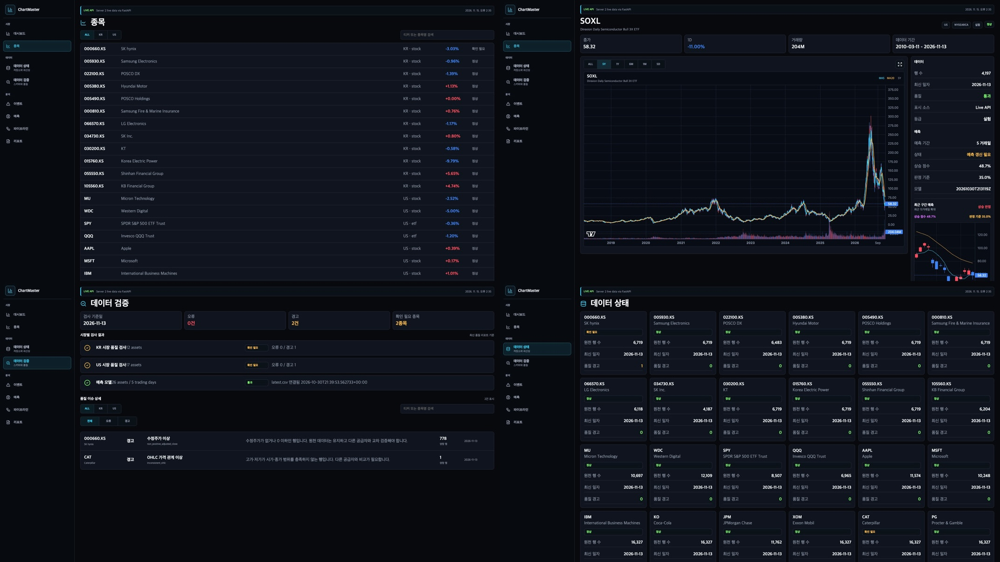
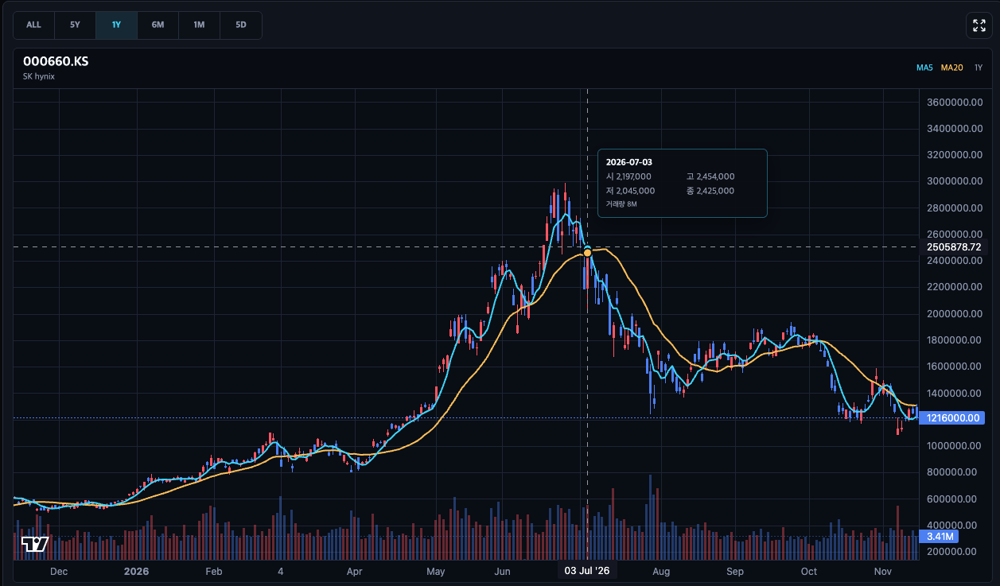
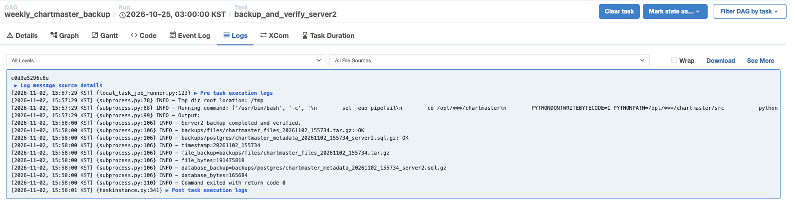
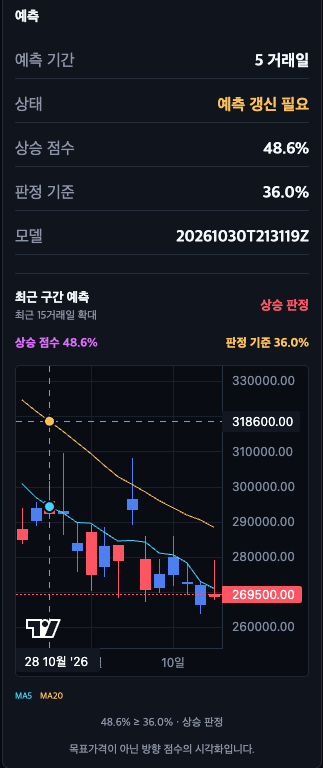
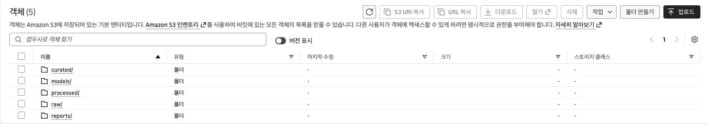

## 개요

ChartMaster는 한국·미국 시장의 주식 데이터를 이용해 데이터 수집부터 저장, 가공, 모델 학습, 외부 요인 분석, 서비스 제공까지 하나의 흐름으로 연결해보는 개인 데이터·인프라 프로젝트다.

단순히 주가를 수집해 차트를 그리거나 예측 모델 하나를 만드는 것이 목적은 아니다. 시장 데이터가 매일 추가되는 환경에서 다음 문제를 직접 해결하는 것이 프로젝트의 중심이다.

- 데이터를 정해진 시간에 반복해서 수집할 수 있는가?
- 서버가 꺼져 있거나 네트워크 장애가 발생해도 누락 데이터를 복구할 수 있는가?
- 원본 데이터와 가공 데이터, 모델 산출물을 목적에 맞게 분리할 수 있는가?
- 어떤 실행이 어떤 데이터 파일을 만들었는지 추적할 수 있는가?
- 모델 학습 결과와 외부 뉴스·문서를 하나의 분석 흐름으로 연결할 수 있는가?
- 로컬 홈서버에서 검증한 구조를 AWS 관리형 서비스로 이전할 수 있는가?

이를 위해 두 대의 Ubuntu 홈서버를 실행 계층과 데이터 계층으로 나누고, Python ETL, Airflow, PostgreSQL, Docker를 단계적으로 연결하고 있다. Electron과 FastAPI를 이용해 저장된 데이터와 예측 결과를 제공하고, S3에는 외부 사본을 복제하도록 확장했다. RDS 상시 운영은 비용을 고려해 보류했으며, SageMaker는 후속 단계에서 관리형 모델 학습을 실습할 계획이다.

데이터 수집과 자동화를 기반으로 조회 화면·API, 품질 관리, 백업·복구, 모델 실행을 연결하고 S3 외부 복제까지 확장했다. 화면과 API는 수집 데이터뿐 아니라 이후 품질·예측 결과도 같은 구조에서 제공할 수 있도록 설계했다. 이 글에서는 단계별 설계 선택과 구현 결과, 운영 과정에서 해결한 문제를 정리한다.


| 항목 | 현재 상태 |
| --- | --- |
| 데이터 소스 | yfinance |
| 관리 자산 | 한국·미국 주식 및 ETF 29개 |
| 실행 환경 | Ubuntu 홈서버 2대, Docker Compose |
| 오케스트레이션 | Apache Airflow 2.10.5, LocalExecutor |
| 파일 저장소 | Server 2의 SSH 파일 저장소 |
| 메타데이터 DB | Server 2의 PostgreSQL 16 |
| 구현 범위 | 수집·자동화, UI·API, 품질 검사, 백업·복원, 모델 예측 연결, S3 외부 복제 |
| 현재 작업 | 모델 실행 이미지 의존성 복구와 정기 실행 재검증, S3 정기 복제 관찰 |

> 이 프로젝트의 예측 결과와 분석 결과는 단순 데이터 엔지니어링 및 MLOps 학습을 위한 산출물이며 투자 추천을 목적으로 하지 않는다.

## 주제 선정

처음에는 채용공고 데이터를 대상으로 ETL 프로젝트를 구성하려 했다. 하지만 일정 기간이 지나면 데이터 구조와 처리 방식이 반복되고, 매일매일 공개되는 데이터 양이 너무 적고, 모델 재학습이나 외부 요인 분석까지 확장하기에는 학습 범위가 제한적이라고 판단했다.

주식 시장 데이터는 매일 새로운 값이 추가되고 한국장과 미국장의 거래 시간이 다르다. 신규 상장 종목은 과거 데이터가 짧고, 데이터 제공자가 이전 값을 수정하거나 특정 날짜를 늦게 제공하는 경우도 있다. 여기에 기업 실적, 금리, 환율, 산업 이슈, 정책 변화 같은 외부 문서까지 연결할 수 있다.

이런 특성은 단순 수집 이외에도 다음 주제를 계속 확장해보기 적합했다.

```text
정기 수집과 백필
  -> 누락·중복 처리
  -> Raw / Processed / Curated 저장 계층
  -> 실행 및 데이터셋 메타데이터
  -> 모델 학습과 평가 이력
  -> 뉴스·리포트 기반 외부 요인 분석
  -> API와 데스크톱 대시보드
  -> AWS 관리형 서비스 이전
```

따라서 ChartMaster의 첫 번째 목표는 높은 예측 정확도가 아니다. 데이터와 실행 이력을 다시 확인할 수 있고, 같은 작업을 재실행해도 데이터가 망가지지 않으며, 장애 이후에도 복구 가능한 파이프라인을 만드는 것이 우선이다.

## 단계별 계획

프로젝트는 수집·조회·품질·운영·모델·AWS 연동으로 범위를 나눴다. 각 단계의 산출물이 API와 파이프라인을 통해 연결되도록 구성했다.

| Phase | 주제 | 구현 목표 | 상태 |
| --- | --- | --- | --- |
| 1 | yfinance·PostgreSQL | 자산 레지스트리, 과거 OHLCV 백필, SSH 파일 저장소, 피처 생성, PostgreSQL 메타데이터 | 완료 |
| 2 | Airflow·Docker | 한국장·미국장 DAG, 저장 데이터 기반 누락 복구, 5달력일 Overlap, Merge/Dedup, Retry | 운영 중 |
| 3 | Electron·React | 화면 정보 구조를 만들고 Mock JSON으로 API 응답 형태 확정 | 완료 |
| 4 | FastAPI | Electron과 파일·DB 사이의 API 경계 및 Mock/Live Provider 구현 | 핵심 연결 구현 |
| 5 | pykrx·거래소 캘린더 | Coverage, 누락, 중복, 날짜 범위 검사와 백필·재처리 절차 구현 | 완료 |
| 6 | pg_dump·백업 | 파일·DB 백업, 복원 훈련, Airflow 장애 대응, 모니터링 | 백업 자동화·임시 복원·일부 장애 실험 검증 |
| 7 | XGBoost·PyTorch | Baseline 모델, 시계열 분할, 평가 지표와 모델 버전 기록 | 모델 비교·일별 예측 연결, 실행 환경 재검증 필요 |
| 8 | S3·IAM | 로컬 주 저장소 유지, 최소 권한 IAM, S3 복제·무결성 검증 | 수동 검증 완료, 정기 실행 관찰 필요 |
| 9 | SageMaker 사용 | SageMaker Training Job, CloudWatch 로그·지표·비용 점검 | 계획 |
| 10 | RAG | 뉴스·문서 검색, 근거 요약, 감성·이벤트 분석 | 후속 확장·보류 |

화면의 Mock 데이터는 API 응답 계약으로 이어지고, 품질 검사 결과는 대시보드와 모델 실행 조건에 사용된다. 모델 산출물과 평가 기록도 같은 조회 계층으로 제공한다. RAG는 이 구조에 추가할 후속 기능으로 남겨 두었다.

이 글은 Phase 1~8의 구현과 검증을 다룬다. Phase 9·10은 후속 확장으로 구분하며, 각 단계의 수동 검증과 정기 운영 확인은 별도로 기록한다.

## 기술 구성

현재 사용하는 기술과 이후 도입할 기술을 구분했다.

| 영역 | 현재 사용 | 이후 도입 계획 |
| --- | --- | --- |
| Language | Python 3.10, TypeScript | - |
| Data Collection | yfinance, pykrx_naver 보조 교차 검증 | 추가 원천 비교 |
| Data Processing | pandas | 필요 시 Parquet 기반 처리 |
| Workflow | Apache Airflow 2.10.5 | AWS 연동 Operator |
| Runtime | Docker, Docker Compose | AWS 관리형 실행 환경 검토 |
| Storage | Server 2 SSH 파일 저장소, Amazon S3 외부 복제 | 복제본 복원·보존 정책 검증 |
| Metadata DB | PostgreSQL 16 | Amazon RDS PostgreSQL은 비용상 보류 |
| ML | scikit-learn, XGBoost, PyTorch 기반 LSTM·Transformer-lite·Ensemble 비교 | 실행 이미지 의존성 복구, SageMaker 학습 실습 |
| API | FastAPI 가격·품질·예측·Airflow 실행 이력 조회 | 인증 연동 |
| Desktop | Electron, React, Lightweight Charts, 예측·품질 상세 화면 | RAG 결과 연결은 보류 |
| AI/RAG | 구조 및 모듈 초안 | 문서 수집, Embedding, Vector Index, AI Report |

## 아키텍처

홈랩은 실행 계층과 데이터 계층을 두 대의 서버로 분리했다.

```text
                         Server 1
                  Compute / Orchestration
                ┌─────────────────────────┐
                │ Docker Compose          │
                │ ├─ Airflow Webserver    │
                │ ├─ Airflow Scheduler    │
                │ └─ Airflow PostgreSQL   │
                │                         │
                │ Python ETL              │
                │ Feature Engineering     │
                └────────────┬────────────┘
                             │
                    SSH      │      PostgreSQL
               file read/write        metadata
                             │
                ┌────────────▼────────────┐
                │        Server 2         │
                │ Data / Persistence      │
                │                         │
                │ File Storage            │
                │ ├─ raw                  │
                │ ├─ processed            │
                │ ├─ curated              │
                │ └─ models               │
                │                         │
                │ PostgreSQL 16           │
                └─────────────────────────┘
```

Server 1은 데이터 수집, 피처 생성, Airflow 스케줄링을 수행한다. Server 2는 파일과 프로젝트 메타데이터를 영속적으로 보관한다. Airflow가 자체적으로 사용하는 PostgreSQL과 ChartMaster 메타데이터 PostgreSQL은 목적이 다르므로 분리했다.

| 저장소 | 위치 | 역할 |
| --- | --- | --- |
| Airflow Metadata DB | Server 1 Docker | DAG Run, Task Instance 등 Airflow 내부 상태 |
| ChartMaster Metadata DB | Server 2 Docker | 자산, 파이프라인 실행, 데이터셋 위치와 행 수 |
| ChartMaster File Storage | Server 2 파일시스템 | OHLCV 원본과 피처 데이터 |

로컬 PC의 Electron은 Server 1의 FastAPI를 호출해 저장된 가격·품질·예측 결과를 조회한다. 품질 검사를 통과한 파일은 별도 Airflow 태스크에서 S3로 복제하며, 주 저장소와 API 읽기 경로는 Server 2를 유지한다.

## 저장 구조

실제 시계열 데이터는 파일로 저장하고 PostgreSQL에는 파일을 추적하기 위한 메타데이터만 저장한다.

```text
/home/dnhs02/iwantdataengineer/chartmaster/
├── raw/
│   └── market_data/
│       └── provider=yfinance/
│           └── symbol={symbol}/
│               └── data.csv
├── processed/
│   └── features/
│       └── symbol={symbol}/
│           └── data.csv
├── curated/
├── models/
├── reports/
├── logs/
└── backups/
```

경로에 provider와 symbol을 명시해 파일의 출처와 대상을 경로만으로 식별할 수 있게 했다. S3 외부 복제에서도 같은 상대 경로를 사용한다.

```text
local  /raw/market_data/provider=yfinance/symbol=005930.KS/data.csv
AWS    s3://<bucket>/raw/market_data/provider=yfinance/symbol=005930.KS/data.csv
```

## Phase 1. yfinance·PostgreSQL

### 종목과 원천

먼저 Airflow 없이 실행할 수 있는 ETL을 만들었다. 수집 로직 오류와 스케줄러 오류를 분리해서 확인하기 위해서다.

`config/assets.json`에서 심볼·시장·거래소·자산 유형·모델링 등급을 관리하고 `--market`, `--tier`, `--symbols`로 수집 대상을 선택한다. 일반 자산은 `core`, 짧은 이력이나 레버리지 특성이 있는 자산은 `experimental`로 구분했다.

수집 필드는 다음과 같다.

```text
date, open, high, low, close, adjusted_close, volume
```

공급자가 제공하는 과거 이력은 상장 이후 전체 기간과 다를 수 있었다. 시작일을 더 과거로 지정해도 없는 데이터가 생기지는 않으므로, 실제 반환된 시작일과 종료일을 확인해야 했다.

### 병합과 저장

날짜를 통일하고 오름차순 정렬한 뒤 중복을 제거했다. 기존 raw와 새 데이터를 합칠 때는 같은 날짜의 새 행을 유지한다.

```text
기존 raw + 새 수집 데이터
    -> 날짜 정렬 -> 중복 제거 -> 병합 파일 저장
```

반복 실행해도 날짜별 행이 늘어나지 않도록 했으며, 전체 교체는 `--replace-existing`으로 명시적으로 구분했다. 저장소는 `LocalObjectStorage`와 `SshObjectStorage`로 분리하고 실제 운영 데이터는 서버2에 저장했다.

### 피처와 기록

수익률, 이동평균, 변동성, 거래량 변화율 등을 생성하고 이후 RSI·MACD·Bollinger·ATR·모멘텀을 추가했다. `close × volume`은 거래대금 근사값이며 거래소의 공식 거래대금과 같지는 않다.

```text
future_5d_return = close(t+5) / close(t) - 1
target_positive_5d_return = future_5d_return > 0
```

미래 가격이 없는 마지막 5개 행의 타깃은 결측값으로 두고 학습에서 제외한다. 미래 수익률과 타깃 자체를 학습 입력으로 사용하지 않는다.

메타데이터는 `assets`, `pipeline_runs`, `datasets`에 기록하고, 후속 단계에서 `data_quality_issues`, `model_versions`, `model_metrics`도 활용했다. 종목별 실패는 정상 결과와 분리해 `partial_success`로 남겼다.

초기 확인 당시에는 자산 29개, raw 약 21MB, processed 약 64MB, 성공 실행 34건과 datasets 712행을 기록했다. 이 수치는 현재 용량·실행 횟수가 아니라 초기 구현 시점의 결과다.

<!-- [사진 삽입·선택: PostgreSQL 조회 결과 — datasets의 symbol, row_count, start_date, end_date와 pipeline_runs의 실행 상태를 보여준다. 비밀번호·접속 문자열은 제외한다. 현재 조회 결과라면 위 초기 수치와 구분해 촬영일을 적는다.] -->

## Phase 2. Airflow·Docker

### 시장별 실행

서버1에서 Airflow webserver·scheduler·내부 PostgreSQL을 Compose로 실행했다. `airflow-init`가 초기화하며 UI는 호스트 8081 포트를 사용한다.

| DAG | 실행 시각 | 시간대 |
| --- | --- | --- |
| `daily_kr_market_data_etl` | 평일 16:10 | Asia/Seoul |
| `daily_us_market_data_etl` | 평일 17:30 | America/New_York |

미국장은 고정 한국 시각으로 환산하지 않고 시장 시간대를 사용해 DST를 처리했다. 시장 기준 날짜는 실제 실행 시각이 아니라 `data_interval_end`에서 얻는다.

### 누락 복구

초기에는 Catchup과 10일 overlap을 사용했지만, 현재는 **`catchup=False` + 저장 데이터 기반 복구**로 바꿨다. 서버가 오래 꺼져 있어도 과거 실행을 모두 만들기보다 최신 실행에서 필요한 수집 범위를 확장한다.

1. 최근 5달력일은 정정 반영을 위해 다시 수집한다.
2. 수집 전에 기존 날짜와 예정 거래 세션을 최신부터 5거래일씩 비교한다.
3. 블록에 누락이 있으면 시작일을 확장하고 이전 블록도 확인한다.
4. 완전한 블록을 만나거나 최대 52블록에 도달하면 멈춘다.
5. 확장한 기간을 받아 기존 데이터와 병합·중복 제거한다.

실패 DAG 이력을 성공으로 바꾸는 기능은 아니다. 완전한 최근 블록보다 오래된 내부 공백이나 최초 전체 이력은 품질 검사와 별도 백필로 다룬다.

### 재시작과 재시도

태스크는 20분 간격으로 최대 3회 재시도하고 `max_active_runs=1`로 DAG별 동시 실행을 제한했다. `depends_on_past=False`로 이전 실패가 다음 실행을 막지 않도록 했다.

컨테이너에는 `restart: unless-stopped`를 적용했다. 다만 Docker 부팅 시작, DAG 비일시정지, 인증·네트워크까지 맞아야 하므로 재시작 정책 하나로 무조건 복구되는 것은 아니다.

<figure class="project-figure">
  
</figure>

## Phase 3. Electron·React

Electron은 Mock 데이터로 정보 구조부터 잡고 실제 데이터로 연결했다. 종목별 가격·거래량·이동평균, 최신 데이터 날짜와 품질 상태를 한 화면에서 확인할 수 있게 했다.

전체 기간과 `5Y / 1Y / 6M / 1M / 5D`를 제공하고, hover로 날짜·OHLCV를 확인하도록 했다. 처음에는 선택 기간만 받아 과거로 이동하면 빈칸이 나왔다. 전체 이력을 유지한 채 보이는 범위만 바꾸는 방식으로 수정했다.

<figure class="project-figure">
  
</figure>

전체 차트에서 짧은 예측이 보이지 않는 문제는 최근 구간을 확대한 작은 차트로 분리해 해결했다. 품질 경고와 확인 필요 상태도 개수만 보여주지 않고 상세 내용을 확인하도록 보완했다.

## Phase 4. FastAPI

Electron이 서버2 파일·DB에 직접 연결하지 않도록 서버1 FastAPI를 제공 계층으로 뒀다. API는 저장된 가격·품질·예측 결과와 Airflow 실행 이력을 전달한다. 화면을 열 때마다 모델을 재학습하지는 않는다.

Mock과 Live 출처를 구분하고 Live 연결 실패를 Mock 성공 화면으로 숨기지 않았다. 데이터가 최신인 것과 Airflow 실패 이력이 없는 것은 다르므로 상태도 따로 표시한다.

이 구조 덕분에 저장소와 인증 정보는 서버 쪽에 두고, 로컬 PC는 API 주소만 설정해 결과를 볼 수 있다. 현재 API 자체 인증은 없으므로 LAN/VPN 내부에서만 사용한다. CORS는 사용자 인증의 대체 수단이 아니다.

<!-- [사진 삽입·선택: FastAPI /docs — 가격 API의 요청과 실제 200 응답 일부가 함께 보이도록 캡처한다. 엔드포인트 목록만 길게 찍기보다 symbol과 날짜별 OHLCV 응답을 보여준다.] -->

## Phase 5. pykrx·거래소 캘린더

날짜 사이의 공백이 모두 누락은 아니었다. 주말·휴장과 실제 누락을 구분하기 위해 거래소 세션을 기준으로 검사했다. 필수 값·최신성·중복·피처 정합성을 확인하고, 공급자 보정 방식처럼 단정하기 어려운 항목은 경고로 분리했다.

Yahoo 원천에서 OHLC 관계 모순과 보정주가 이상을 발견했다. 원본은 보존하고 `pykrx_naver`로 교차 확인한 결과를 curated에 저장했다. 이 경로는 Naver 기반이므로 독립 KRX 원천 검증과 동일하다고 보지는 않았다.

당시에는 OHLC 이상 16행과 누락 거래 세션 5개를 보완했다. 최종 검사 기록은 29종목 통과·오류 0·경고 1이었으며 남은 경고는 SK하이닉스 과거 보정주가 이상 778행이었다. 이는 해당 검사 시점의 결과다.

백필은 공급자를 다시 조회하는 작업이고 재처리는 저장된 데이터로 피처를 다시 만드는 작업이다. 이를 분리하고 품질 오류가 있으면 후속 예측·S3 복제를 막는 gate를 추가했다.

## Phase 6. pg_dump·백업

서버2 파일과 PostgreSQL을 따로 백업하고 실제 복원도 확인했다. 파일은 tar archive로, DB는 `pg_dump`로 만들고 운영 DB 대신 임시 DB에 복원했다.

이후 매주 일요일 03:00 KST에 `weekly_chartmaster_backup`을 실행하도록 구성했다. tar 목록·gzip·SHA256 검사를 통과해야 성공하며 기존 백업을 자동 삭제하지는 않는다.

2026-11-02 검증에서는 파일 백업 191,475,818 bytes와 DB dump 165,684 bytes의 무결성을 확인했다. FastAPI·Airflow 재시작, 품질 실패와 SSH 실패 시뮬레이션도 수행했다. 운영 영향이 큰 PostgreSQL 강제 중단 실험은 보류했다.

<figure class="project-figure">
  
</figure>

백업 파일이 존재하는 것과 복원할 수 있는 것은 다르다. 같은 서버 디스크의 백업만으로 물리 장애까지 대비할 수도 없으므로 외부 사본도 별도로 검토했다.

## Phase 7. XGBoost·PyTorch

문제를 ‘5거래일 뒤 상승 여부’로 좁히고 전체 기간·2020년 이후·최근 5년 데이터셋을 나누어 검토했다. 오래된 차트가 횡보처럼 보인다는 이유만으로 제외하기보다 구간별 결과를 비교하려 했다.

시간순으로 학습·검증·test를 나누고 검증 구간에서 threshold를 선택했다. 아래는 전체 기간 비교의 과거 실행 결과이며 모델별 평가 가능한 행이 달라 동일 subset 비교도 함께 확인해야 한다.

| 모델 | Test F1 | Test ROC-AUC |
| --- | ---: | ---: |
| Random Forest | 0.6715 | 0.5252 |
| XGBoost | 0.6817 | 0.5417 |
| LSTM | 0.7238 | 0.5091 |
| Transformer-lite | 0.7271 | 0.5133 |
| Ensemble | 0.7208 | 0.5044 |

Transformer-lite를 자동화 기준 모델로 선택했지만 ROC-AUC가 0.5 근처라 강한 예측력을 입증한 것은 아니다. 앙상블 역시 같은 평가 subset의 항상 상승 baseline보다 개선되지 않았다. 목표에 맞춰 모델 연구를 더 늘리기보다 학습·평가·버전·예측 제공을 연결하는 데 집중했다.

품질 검사 뒤 일별 학습·예측을 실행하고 산출물과 지표를 서버2·PostgreSQL에 기록해 API와 Electron으로 제공하도록 연결했다.

<figure class="project-figure">
  
</figure>

상승 점수가 50% 미만이어도 모델 threshold를 넘으면 상승 판정일 수 있다. 화면도 같은 기준을 사용해야 한다. 예측 연장선은 방향·최근 변동성으로 구성한 시나리오이며 미래 종가를 직접 예측한 회귀 결과나 통계적 신뢰구간이 아니다.

2026-11-13에는 현재 Airflow 이미지의 `torch`·`xgboost` 누락을 확인했다. 과거 학습 완료와 현재 자동 실행 정상 여부는 별개이므로 의존성 복구 후 정기 실행 재검증이 필요하다.

## Phase 8. S3·IAM

### 비용과 범위

처음에는 S3와 RDS Multi-AZ로 전체 이전하려 했지만, 작은 DB에도 상시 컴퓨팅 비용이 발생했다. 2026-11-13 조회한 구성에서는 RDS 컴퓨팅·최소 저장 비용만 약 $42.47/월이었고 부가 비용은 별도였다.

현재는 **서버1·서버2 유지 + S3 외부 복제**를 선택했다. RDS·Multi-AZ와 연결용 EC2/VPN은 생성하지 않았다. Multi-AZ는 가용성을 위한 DB 복제이지 백업 자체가 아니라는 점도 구분했다.

### 복제와 검증

서울 S3 bucket에 공개 차단, SSE-S3 암호화, Versioning을 적용했다. 서버2의 `raw / curated / processed / models / reports`를 같은 key 구조로 복제했다.

| 항목 | 2026-11-13 결과 |
| --- | --- |
| Object 수 | 1,054개 |
| 데이터 크기 | 486,361,388 bytes |
| 검증 | 재다운로드 후 SHA256 전체 비교, 차이 없음 |

사람용 CLI 임시 로그인과 자동 복제 인증도 분리했다. 자동화 전용 IAM 사용자에는 지정 bucket과 다섯 prefix의 조회·쓰기만 허용하고, 삭제·IAM 관리·다른 bucket 접근은 허용하지 않았다. credential은 Git 밖 전용 파일로 관리하고 컨테이너에는 read-only로 연결했다.

품질 성공 후 예측과 별도 분기로 S3 복제를 실행하도록 연결했다. 변경된 파일만 업로드하되 변경 없음으로 판단한 파일도 다시 읽어 SHA256을 확인한다. 복제 태스크끼리는 pool slot 1개로 직렬화했다.

<figure class="project-figure">
  
</figure>

컨테이너 수동 실행은 검증했지만 이후 정기 KR/US 태스크의 첫 성공은 추가 확인이 필요하다. 매번 파일 읽기·요청·다운로드가 발생하고 Versioning으로 이전 사본도 쌓이므로 저장 용량만으로 비용을 판단하면 안 된다.

현재 S3 복제에는 PostgreSQL dump가 포함되지 않는다. 서버2 주간 백업은 유지하고 DB dump 외부 보관·버전 복원·보존 정책은 후속 과제로 남겼다.

## 배운 점

| 문제 | 배운 점·대응 |
| --- | --- |
| Docker socket 권한 오류 | Compose 파일과 daemon 접근 권한은 별개. 그룹 변경 후 세션 갱신 필요 |
| 컨테이너의 SSH 접근 실패 | UID·파일 권한·키 경로를 각각 확인 |
| 서버 중단과 누락 | 스케줄 복구와 실제 데이터 복구를 구분 |
| 원천 데이터 이상 | raw 보존, 교차 검증, curated 분리 |
| 성공 화면과 실제 실패 불일치 | 데이터·품질·예측·실행 이력을 별도 상태로 표시 |
| AWS 상시 비용 | 전체 이전 대신 필요한 서비스만 도입 |

데이터 엔지니어 관점에서는 멱등 병합·품질·재처리와 산출물 추적을, 인프라 관점에서는 서비스 경계·권한·영속성·복원·비용을 함께 다룰 수 있었다.

## 다음 단계

모델 실행 이미지 의존성 복구와 S3 정기 복제 관찰은 기존 단계의 운영 보강으로 진행한다.

### Phase 9. SageMaker 사용

필요한 때만 SageMaker Training Job을 실행해 S3 입력·모델 산출물·CloudWatch 로그와 비용을 확인할 계획이다. 상시 endpoint 없이 학습 작업 단위로 관리형 실행 환경을 경험한다.

### Phase 10. RAG

뉴스·문서 검색과 RAG 기반 근거 요약은 후속 확장으로 남긴다. 현재는 보류 상태이며 구현한 기능으로 다루지 않는다.

Lambda 웹 전환과 RDS·Multi-AZ 상시 운영도 보류한다. 지금은 기능 수를 늘리기보다 구현한 흐름이 실제로 반복 실행되고 복구 가능한지 증거를 남기는 데 집중한다.
