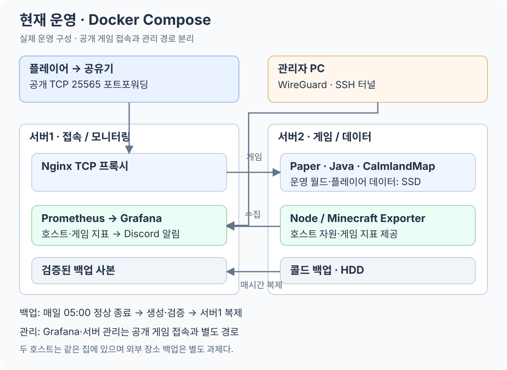
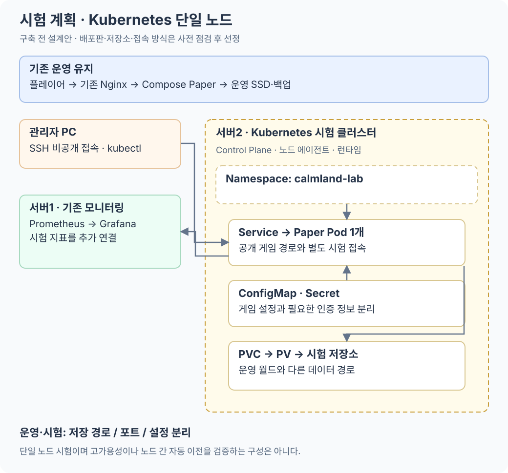

[← 1편: Minecraft 서버 운영 기록]({{ '/projects/minecraftgameserver/' | relative_url }})

## 실습 목적

Calmland는 두 대의 Ubuntu 홈서버에서 Docker Compose로 운영하는 Minecraft 서버다. 공개 접속, 자동 백업, Prometheus·Grafana 모니터링과 Discord 알림까지 구성했다.

현재 규모에서 Kubernetes 전환이 반드시 필요한 것은 아니다. 이번에는 기존 서비스를 대상으로 배포·상태 관리·영속 저장소·복구를 학습하고 Compose와 비교하려고 한다. 운영을 바로 이전하지 않고 별도 시험 환경에서 게임 접속과 데이터 유지까지 검증한다.

> **진행 상태: 설계 단계.** Kubernetes 시험 환경은 아직 구축 전이다.

| 항목 | 실습 범위 |
| --- | --- |
| 목표 | 배포·상태 관리·영속 저장소·복구 학습 |
| 대상 | 서버2의 단일 노드 시험 클러스터, Paper Pod 1개 |
| 운영 서비스 | 기존 Compose·공개 접속·백업 유지 |
| 데이터 | 운영 월드와 분리한 시험 월드 |
| 비교 기준 | 자원 사용량·복구 시간·관리 복잡성 |

## 현재 구성 · Docker Compose

공개 접속은 서버1에서 받고 게임은 서버2에서 실행한다. 모니터링과 백업 사본은 서버1에 두고 두 호스트와 게임 상태를 관측한다.

<figure class="project-figure">
  
  <figcaption>현재 운영 중인 Compose 구성.</figcaption>
</figure>

게임 데이터는 서버2에 영속적으로 저장한다. 백업은 정상 종료 후 생성·검증하고 서버1에도 사본을 보관한다. Grafana와 Prometheus는 공개 게임 포트와 분리해 관리 경로로 접근한다.

## 시험 구성 · Kubernetes

기존 공개 접속·게임·백업을 유지하고 서버2에 단일 노드 시험 클러스터를 추가하는 안이다. 서버1은 기존 모니터링을 유지하고 이후 시험 지표도 수집한다. 아래 구성은 아직 구축 전이며 배포판·저장소·접속 방식은 사전 점검 후 선정한다.

<figure class="project-figure">
  
  <figcaption>구축 전 시험 계획. 운영 월드와 시험 저장소를 분리한다.</figcaption>
</figure>

### Kubernetes 사전 점검

| 점검 대상 | 확인·조치 |
| --- | --- |
| 메모리·CPU | 서버2 메모리 약 8GB에서 운영·시험 동시 실행 여유 확인 |
| 자원 부족 | 다른 장비 또는 공지한 점검 시간 사용 |
| 시험 저장소 | 운영 데이터는 시험 Pod에 연결하지 않음 |
| 네트워크 | 클러스터와 LAN·Docker·WireGuard 대역 충돌 확인 |
| 자원 격리 | 네임스페이스만으로 호스트 자원이 격리되지는 않음 |

| 구분 | 현재 Compose 운영 | Kubernetes 시험 계획 |
| --- | --- | --- |
| 목적 | 실제 이용자 서비스 | 배포·영속성·복구 학습 |
| 게임 데이터 | 기존 운영 월드 | 독립된 시험 월드 |
| 접속 | 공개 도메인·Nginx 프록시 | 관리자용 비공개 경로 |
| 실행 관리 | Compose·재시작 정책 | Kubernetes 워크로드·상태 검사 |
| 저장 | 호스트 볼륨 | PVC·PV와 선정한 저장소 |
| 관측 | 기존 Prometheus·Grafana | 시험 대상 지표를 추가 연결 |

## Paper 배포·접속

이미지·Paper·Java 버전을 기록하고 시험 서버 하나를 배포한다. 워크로드와 업데이트 방식을 선정할 때 같은 월드에 여러 인스턴스가 동시에 쓰지 않도록 한다.

| 구성 | 검증할 내용 |
| --- | --- |
| 배포 명세 | 동일한 이미지·설정으로 재현 가능한 기동 |
| ConfigMap·Secret | 설정 분리, 실제 인증 정보는 Git 제외 |
| requests·limits | JVM 외 메모리와 호스트 여유를 고려한 자원 예산 |
| Service·접속 경로 | 비공개 경로로 실제 로그인·월드 입장 |
| 시작·준비·생존 검사 | 느린 정상 기동과 장애를 구분하고 반복 재시작 방지 |

Pod 실행 표시만으로 완료하지 않고 실제 클라이언트 입장까지 확인한다. 기존 공개 도메인과 운영 프록시는 시험 대상으로 바꾸지 않는다.

## PVC 데이터·복구 검증

월드 데이터는 Pod 수명과 분리한다. PVC 연결 후 기준 좌표에 블록과 상자를 설치하고 아이템을 보관해, 재생성 이후 같은 상태가 유지되는지 확인한다.

| 시험 | 완료 기준 | 상태 |
| --- | --- | --- |
| 정상 종료·재생성 | 블록·상자·플레이어 데이터 유지 | 예정 |
| 시험 Pod 삭제 | Pod 재생성과 실제 게임 재접속 | 예정 |
| 프로세스 비정상 종료 | 복구 시간과 마지막 저장 데이터 확인 | 예정 |
| 잘못된 시험 설정 | 실패 감지와 이전 설정 복구 | 후속 예정 |

정상 종료와 비정상 종료를 구분하고 종료 시점부터 게임 재접속까지 시간을 기록한다. 파괴적인 시험 전에는 별도 백업을 만든다.

PVC는 백업이 아니다. 실제 저장 위치와 삭제 시 보존 정책을 확인하고, 로컬 저장소라면 다른 노드에서 바로 복구할 수 있다고 가정하지 않는다. 단일 노드 단계에서는 노드 장애 시 자동 이전을 검증 범위에서 제외한다.

## Prometheus·Grafana 관측

배포·영속성 확인 뒤 기존 모니터링에 시험 대상을 연결한다. 운영·시험 지표를 구분하고 TPS·MSPT·JVM뿐 아니라 Pod 자원·재시작·노드 여유도 관측한다. 수집 성공과 실제 접속 성공은 따로 확인한다.

| 비교 항목 | Compose 운영 | Kubernetes에서 확인할 것 |
| --- | --- | --- |
| 배포 | Compose 서비스·포트·볼륨 | 워크로드·Service·설정·저장소 명세 |
| 상태 관리 | 재시작 정책·운영 절차 | Pod 재생성·상태 검사·이벤트 |
| 데이터 | 호스트 볼륨·콜드 백업 | PVC·실제 저장소·백업·복원 |
| 자원·관측 | 컨테이너 상한·호스트와 게임 지표 | requests·limits·Pod와 노드 지표 |
| 운영 부담 | 현재 기준선 | 자원 사용·복구 시간·관리 복잡성 |

아직 성능 개선이나 복구 시간 단축 결과는 없다. 복제본 증가가 같은 월드의 처리량 증가를 뜻한다고 가정하지 않고, 단일 인스턴스의 배포와 데이터 보존부터 검증한다.

## 실습 순서

| 순서 | 작업 | 확인할 결과 | 상태 |
| --- | --- | --- | --- |
| 1 | 자원·네트워크 점검, 배포판 선정 | 운영과 함께 실행할 여유·대역 충돌 여부 | 예정 |
| 2 | 클러스터·Paper 배포 | 명세 보관, 실제 로그인·월드 입장 | 예정 |
| 3 | PVC·Pod 복구 시험 | 데이터 유지, 종료부터 재접속까지 걸린 시간 | 예정 |
| 4 | 운영 영향 확인 | 기존 게임·백업·호스트 자원 변화 | 예정 |
| 5 | 모니터링·백업 복원 | 시험 지표 수집, 별도 백업으로 상태 복원 | 예정 |

첫 실습 결과와 실패 원인을 기록한 뒤 운영 이전 여부를 판단한다. 두 서버가 같은 집에 있다는 한계는 Kubernetes 도입으로 해소되지 않는다.

## 실습 기록: 프로그램을 다시 실행해도 파일이 남는지 확인

### 운영 서버 옆에 연습 환경 만들기

먼저 서버2에 별도의 Kubernetes 연습 환경을 만들었다. 운영 중인 마크 서버는 그대로 두고, 작고 가벼운 프로그램으로 자동 재실행과 파일 보존을 확인하기 위해서다.

기존 Docker 안에 Kubernetes 연습 환경을 만들 수 있는 kind를 사용했다. 서버2의 가용 메모리 약 4.5GiB를 확인한 뒤 연습 환경이 사용할 자원을 CPU 1.5개 상당·메모리 2GiB로 제한했다.

| 항목 | 실제 구성 |
| --- | --- |
| 연습 환경 생성 도구 | kind v0.33.0 |
| Kubernetes 버전 | v1.37.0 |
| 실행 장소 | 서버2의 Docker 안에 만든 노드 1개 |
| 준비 상태 | 실행 준비 완료인 Ready 확인 |
| 시험 프로그램 | 가벼운 명령을 실행할 수 있는 BusyBox |
| 저장 공간 | 프로그램과 별도로 연결한 64Mi 공간(PVC) |

kind 설치 파일은 공식 릴리스의 체크섬과 비교해 다운로드한 파일이 일치하는지 확인했다. 운영 월드를 연습 환경에 연결하거나 기존 게임의 공개 접속 경로를 바꾸지는 않았다. 다만 같은 컴퓨터를 사용하므로 CPU·메모리와 호스트 장애의 영향은 공유한다.

```text
서버2 Docker
├─ 기존 마크 서버 → 운영 월드·백업 유지
└─ Kubernetes 연습 환경
   └─ 작은 시험 프로그램 → 별도로 연결한 저장 공간
```

처음에는 실행 준비가 끝나지 않아 시험 프로그램이 대기했다. 상태 기록을 읽어 원인을 확인했고, 노드와 저장 공간이 준비되고 필요한 이미지 다운로드가 끝난 뒤 정상 실행됐다.

### 프로그램을 지운 뒤 저장 파일 확인

Kubernetes에서 프로그램을 실행하는 단위를 **Pod**라고 한다. 이번에는 Pod 하나가 실행되도록 관리하는 설정(Deployment)을 만들고, 파일을 보관할 별도 저장 공간(PVC)을 연결했다.

시험은 다음 순서로 진행했다.

1. 실행 중인 프로그램에서 저장 공간에 고유한 내용의 파일을 썼다.
2. 실행 중인 Pod를 삭제했다.
3. Kubernetes가 새 Pod를 자동으로 만드는지 확인했다.
4. 새 Pod에서 파일을 읽어 처음 저장한 내용과 비교했다.

```text
기존 프로그램 → 별도 공간에 파일 저장
       │
       └─ 실행본 삭제 → Kubernetes가 새 실행본 생성
                                  │
                                  └─ 기존 저장 공간 연결 → 같은 파일 확인
```

| 확인한 내용 | 결과 |
| --- | --- |
| 실행본이 실제로 바뀌었는가? | 삭제 전후 식별자가 달라짐 |
| 새 실행본이 만들어졌는가? | 자동 생성 후 정상 실행 |
| 저장했던 파일이 남았는가? | 처음 쓴 내용과 일치 |
| 삭제 요청부터 파일 재확인까지 | 약 31.19초 |
| 기존 마크 서버 상태 | 확인 시점 healthy·TPS 20 |

즉, **프로그램 실행본은 교체됐지만 별도 공간에 저장한 파일은 유지됐다.** 자동으로 다시 실행하는 기능과 데이터 보존을 함께 확인한 것이다.

31.19초에는 이전 프로그램이 종료되기를 기다리는 시간도 포함된다. 마크 서버를 시험한 것이 아니므로 게임의 장애 복구 시간이라고 설명할 수는 없다. 기존 서버 상태도 해당 시점에 확인한 결과이며 장시간 영향까지 검증한 것은 아니다.

### 확인한 범위와 남은 문제

Pod를 삭제했을 때 이전 실행본이 종료되는 동안 새 실행본이 먼저 실행되는 구간도 있었다. 마크 서버는 같은 월드에 두 서버가 동시에 데이터를 쓰면 문제가 생길 수 있어, 실제 게임 배포에서는 이전 서버가 완전히 종료된 뒤 새 서버가 시작되는 절차를 추가 확인해야 한다.

또한 이번 저장 공간은 kind 노드 안에 있다. **Pod를 바꿔도 파일이 남는 것은 확인했지만, 클러스터 전체를 지우거나 호스트가 고장 났을 때의 복구는 확인하지 않았다.** 별도 백업과 복원도 필요하다.

| 작업 | 상태 |
| --- | --- |
| Kubernetes 연습 환경 준비 | 완료 |
| 작은 프로그램 실행과 저장 공간 연결 | 완료 |
| 실행본 삭제 후 자동 재생성과 파일 보존 | 완료 |
| 연습용 마크 서버 실행·게임 접속 | 다음 단계 |
| 월드 보존·백업 복원·모니터링 연결 | 예정 |

다음에는 작은 시험 프로그램 대신 연습용 Paper 서버를 실행한다. 실제 게임에 접속해 블록과 상자를 설치하고, 서버 실행본을 교체한 뒤에도 같은 상태가 남는지 확인하려고 한다.

실제로 적용한 배포 설정과 확인 명령, 실행본 교체 전후의 식별자와 파일 비교 결과는 프로젝트 저장소에 별도로 기록했다. 환경 구성은 [kind 공식 문서](https://kind.sigs.k8s.io/docs/user/quick-start/)를 참고했다.
