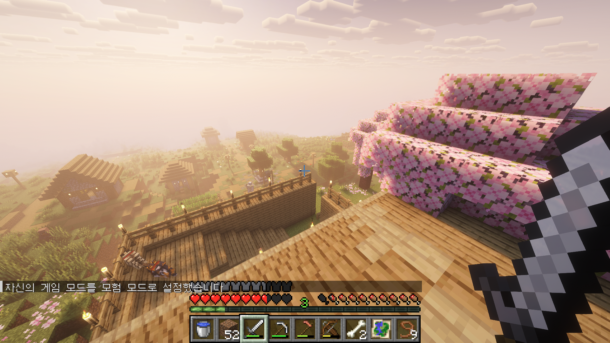
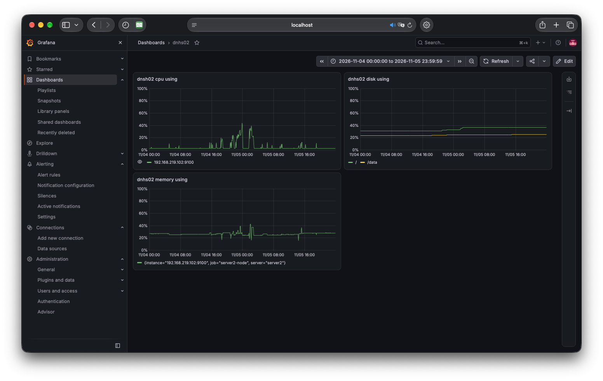
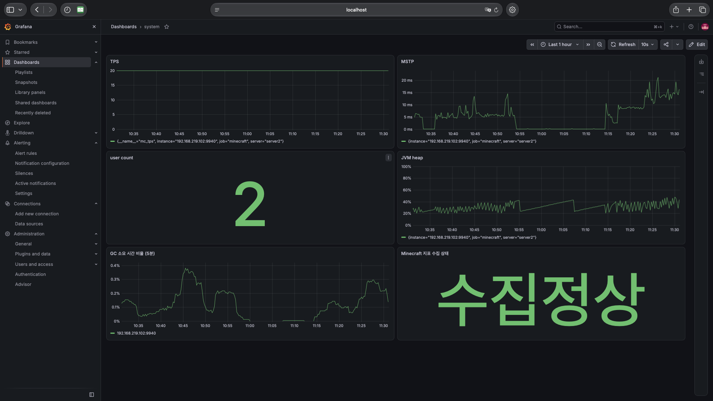
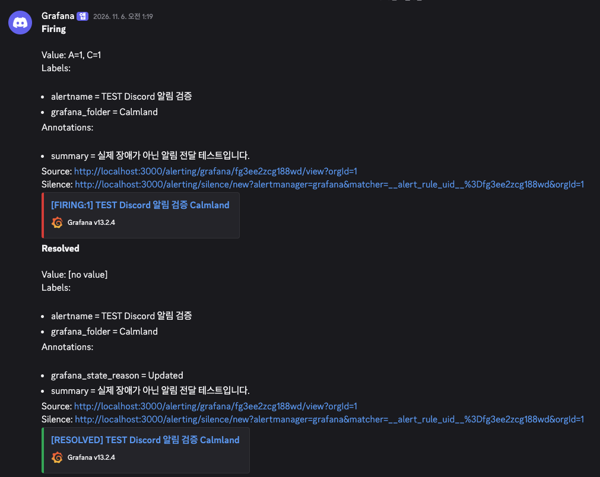
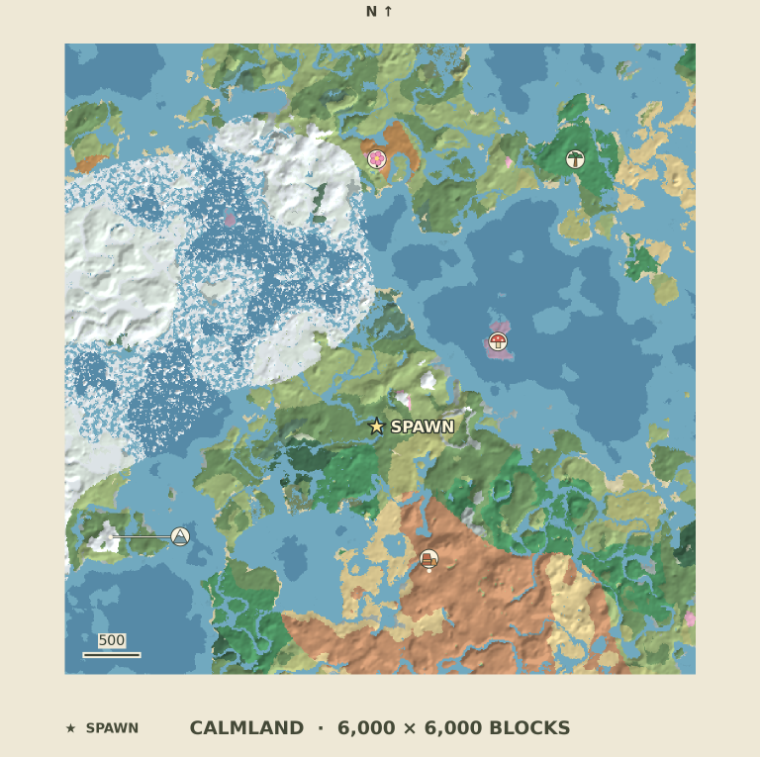

## 프로젝트 개요

Calmland는 두 대의 Ubuntu 홈서버에서 운영하는 Minecraft 서바이벌 서버다. 처음에는 함께 탐험할 월드를 만드는 것으로 시작했지만, 지형 로딩 문제를 겪으면서 성능 측정과 운영 구조 개선으로 프로젝트의 중심을 옮겼다.

지금은 공개 접속 경로, 월드 사전 생성, 자동 백업과 다른 호스트로의 복제, 호스트·게임 지표 수집과 Discord 알림까지 연결했다. 이 글에는 기능 목록보다 문제를 어떻게 확인했고 어떤 근거로 설정과 운영 범위를 정했는지를 남겼다.

| 항목 | 마지막 확인한 구성 |
| --- | --- |
| 실행 환경 | Ubuntu 홈서버 2대, Docker Compose |
| 게임 서버 | Paper 26.3 build 194, Java 25 |
| 공개 접속 | DuckDNS → 공유기 → 서버1 Nginx TCP 프록시 → 서버2 Paper |
| 게임 자원 한도 | 컨테이너 CPU 3개 상당·메모리 3GiB, JVM 최대 heap 2GiB |
| 운영 정원·월드 | 최대 10명, 오버월드 6,000 × 6,000블록 |
| 모니터링 | Node Exporter·Prometheus·Grafana, Minecraft Prometheus Exporter |
| 데이터 보호 | 일일 콜드 백업, 서버1 검증 사본, CoreProtect 변경 이력 |
| 알림·문의 | Grafana → Discord 운영 알림, 별도 문의·신고 채널 |

<figure class="project-figure">
  
</figure>

## 기술 구성

| 영역 | 사용 기술·역할 |
| --- | --- |
| OS·실행 | Ubuntu, Docker, Docker Compose |
| 게임 | Paper, Java, 직접 개발한 CalmlandMap 플러그인 |
| 접속·관리 | Nginx TCP 프록시, DuckDNS, WireGuard, SSH |
| 자동화 | Python, cron, systemd 방화벽 서비스 |
| 지표 | Node Exporter, Minecraft Prometheus Exporter, Prometheus |
| 시각화·알림 | Grafana, Discord Webhook |
| 변경 기록 | CoreProtect |
| 후속 계획 | Loki·Alloy 중앙 로그, 복원 훈련, 장애 대응 기록 |


## Minecraft 지형 로딩

### Paper 서버 구축

나는 Linux, Docker, JVM과 네트워크를 배우면서 함께 즐길 Minecraft 홈서버를 만들었다. 처음에는 Vanilla+ 탐험 서바이벌을 목표로 건축물·던전·보상을 배치하고, Tectonic과 Dungeons and Taverns로 지형과 구조물을 확장했다.

직접 만든 플러그인으로 발견 기록과 개인 보상, 던전 기능도 추가했다. 콘텐츠가 늘면서 월드뿐 아니라 보상·재생성·보호 상태까지 관리해야 했다. 점차 운영 학습보다 콘텐츠 개발에 시간을 더 쓰게 됐고, 지형 로딩 문제를 계기로 프로젝트의 중심을 다시 정했다.

### Minecraft 청크 지연

나는 크리에이티브 이동 시험에서 지형이 늦게 표시되는 문제를 확인했다. 별도의 동기 청크 강제 생성 시험에서도 최대 약 31초의 틱 지연을 측정했다. 일반 플레이와 조건이 다른 시험이므로 이를 평소 이동 지연으로 해석하지는 않았다.

접속이 된다는 것만으로 충분하지 않았다. 나는 설정을 바꾸기 전에 생성 작업 중 자원 사용과 실제 플레이 상태를 측정하기로 했다.

### TPS·JFR 성능 측정

나는 유휴 상태, 미생성 지형 요청, 실제 1인 이동을 나눠 측정했다.

<table>
  <thead>
    <tr><th scope="col">관측 대상</th><th scope="col">확인 목적</th></tr>
  </thead>
  <tbody>
    <tr><td>호스트·컨테이너 CPU</td><td>사용량과 CPU 시간 제한</td></tr>
    <tr><td>JVM·컨테이너 메모리</td><td>heap·GC·메모리 한도</td></tr>
    <tr><td>TPS·MSPT</td><td>게임 틱 지연</td></tr>
    <tr><td>디스크·swap</td><td>저장장치 대기와 메모리 압박</td></tr>
    <tr><td>JFR·플레이 피드백</td><td>실행 경로와 체감 문제 대조</td></tr>
  </tbody>
</table>

동기 생성 시험에서는 청크 계산·메인 스레드 대기와 CPU throttling을 함께 확인했다. 반면 실제 이동에서는 계측성 GC 구간을 제외한 TPS 표본 22개가 모두 20이었는데도 지형 표시 지연이 남았다.

나는 **정상 TPS만으로 사용자 경험을 설명할 수 없다는 결론**을 내렸다. 당시 자료로 전송·네트워크·클라이언트까지 원인을 특정하지는 못했다. JFR의 heap inspection GC가 측정에 지연을 더한 점도 확인해, 후속 시험에서는 가벼운 자원·JVM counter·spark 표본을 사용했다.

## Minecraft 청크 사전 생성

### 운영 범위 조정

나는 기능 수보다 제한된 자원에서 운영 범위를 정하고 결과를 검증하는 과정에 집중하기로 했다. 게임은 자연 지형에서 건축과 채집을 즐기는 일반 서바이벌로 바꾸고 Calmland라는 이름을 붙였다.

<table>
  <thead>
    <tr><th scope="col">항목</th><th scope="col">기존 탐험 서버</th><th scope="col">전환한 Calmland</th></tr>
  </thead>
  <tbody>
    <tr><td>게임 중심</td><td>건축물·던전·보상 진행</td><td>자연 지형에서 자유롭게 생활</td></tr>
    <tr><td>지형</td><td>지형·구조물 생성 팩</td><td>기본 자연 지형</td></tr>
    <tr><td>직접 개발한 기능</td><td>탐험·던전·보상 중심</td><td>지도·접속·생활 보조 중심</td></tr>
    <tr><td>월드 운영</td><td>미생성 지역까지 탐험</td><td>제한한 범위를 사전 생성</td></tr>
    <tr><td>개발 목표</td><td>콘텐츠 확장</td><td>관측·복구·장애 대응</td></tr>
  </tbody>
</table>

나는 기존 소스·측정 자료·월드를 보존하고 새 서비스로 전환했다. 후보 시드를 직접 비교해 다양한 환경이 가까이 있는 월드를 골랐고, 오버월드 범위를 4,000×4,000블록으로 정했다.

### 생성 결과 검증

나는 플레이 중 발생하던 지형 생성 비용을 서비스 준비 단계로 옮겼다. 보더 내부와 시야 여유 구간을 미리 생성해 디스크에 저장하고, 플레이할 때 필요한 청크를 읽도록 했다.

```text
준비 단계: 청크 생성 → 디스크에 저장
플레이 단계: 사용자 이동 → 저장한 청크 로딩 → 전송 → 화면 표시
```

<table>
  <thead>
    <tr><th scope="col">준비·검증 항목</th><th scope="col">결과</th></tr>
  </thead>
  <tbody>
    <tr><td>보더 내부 청크</td><td>62,500개</td></tr>
    <tr><td>각 방향 6청크 여유를 포함한 범위</td><td>68,644개</td></tr>
    <tr><td>생성 시간</td><td>약 24분 9초</td></tr>
    <tr><td>저장 파일에서 FULL 상태 확인</td><td>68,644개</td></tr>
    <tr><td>누락·파싱·좌표 오류</td><td>0</td></tr>
  </tbody>
</table>

나는 정상 종료 후 실제 저장 파일의 좌표와 상태까지 검사했다. 사전 생성은 오버월드에 적용했고, 네더·엔드는 포함하지 않았다. 준비 시간과 디스크를 먼저 사용하는 대신 플레이 중 생성 부담을 줄였다. 디스크 읽기와 전송 비용은 여전히 남는다.

### Docker 자원·TPS 비교

나는 새 구성에서도 1인 이동을 기록하고, 크리에이티브 확인 이후 4분 49초를 이전 시험과 비교했다.

<table>
  <thead>
    <tr><th scope="col">관측 항목</th><th scope="col">기존 서버 1인 이동</th><th scope="col">전환 후 1인 이동</th></tr>
  </thead>
  <tbody>
    <tr><td>분석 구간</td><td>6분 42초</td><td>4분 49초</td></tr>
    <tr><td>CPU 평균</td><td>139.99%</td><td>56.58%</td></tr>
    <tr><td>컨테이너 working set 최대</td><td>약 1,771MiB</td><td>약 1,219MiB</td></tr>
    <tr><td>최근 10초 TPS 표본</td><td>계측성 GC 제외 22개 모두 20</td><td>19개 모두 20</td></tr>
    <tr><td>플레이 피드백</td><td>지형이 늦게 나타남</td><td>이전보다 개선, 같은 현상 미보고</td></tr>
  </tbody>
</table>

나는 전환 후 평균 CPU·메모리 사용이 낮아지고 플레이 피드백도 개선된 것을 확인했다. 이 표의 CPU는 논리 CPU 하나를 100%로 계산했다.

다만 시드·Paper 버전·콘텐츠·자원 한도·계측 조건을 함께 바꿨으므로 사전 생성만의 개선율로 주장하지는 않았다. 순간적인 틱 지연도 남아 있어, **이번 1인 플레이에서 개선을 확인한 결과**로 범위를 한정했다. 다중 접속과 장기 안정성은 추가 검증이 필요하다.

## Nginx 접속·백업 구성

### Nginx TCP 프록시

나는 서버1에서 접속을 받고 서버2에서 게임을 실행하도록 구성했다.

```text
Minecraft 클라이언트
    → 공유기 TCP25565
    → 서버1 Nginx TCP 프록시
    → 서버2 TCP25569: Docker → Paper / Java
         ├─ SSD: 월드·플레이어·플러그인
         └─ HDD: 콜드 백업 → 서버1 사본
```

서버2의 다른 서비스와 자원을 나누기 위해 게임 컨테이너에 CPU quota 3, 메모리 3GiB, JVM 최대 heap 2GiB를 설정했다. 나는 게임용 공개 포트와 관리용 WireGuard·SSH 경로를 구분하고, 외부 회선에서 온라인 계정 인증과 월드 입장까지 확인했다.

접속 문제를 해결할 때는 DNS 오류, TCP 시간 초과, 계정 세션 오류를 나눠 조사했다. Nginx 연결 기록과 Paper 입장 기록을 대조해, 프록시 도달과 실제 게임 접속을 구별했다.

### Python·cron 백업 자동화

나는 매일 05:00 KST에 서버를 잠시 정상 종료하고 콜드 백업하도록 구성했다.

```text
중복 실행 잠금 → 정상 종료 → 데이터·Compose 백업
    → 압축·원본 대조·체크섬 검증 → 백업 확정
    → 기동·healthy 확인 → 성공한 자동 백업 최근 5개 유지
```

월드·플레이어·플러그인·CoreProtect DB를 같은 시점으로 보존한다. 서버1에서는 매시간 완료 백업을 가져와 검증한 뒤 사본으로 확정하고, 실패하면 기존 정상 사본을 유지하도록 했다.

나는 백업 생성·검증·호스트 간 사본 보관까지 구성했다. 외부 장소 백업은 프로젝트 범위에서 제외했다. 두 호스트가 같은 집에 있어 장소 전체 손실에는 대응하지 못한다. 이후 부하 시험에서는 백업을 별도 시험 경로에 복원해 기동했지만, 온라인 계정의 플레이어 데이터까지 확인하고 복구 시간과 데이터 손실 범위를 기록하는 종합 복원 훈련은 남아 있다.

## Prometheus·Grafana 모니터링

### Linux 자원 점검

나는 특정 시험 때만 수집하던 지표를 평소에도 기록하기로 했다. 문제가 발생한 뒤의 상태뿐 아니라 언제부터 변했는지 확인하기 위해서다.

먼저 두 호스트에서 메모리·디스크·컨테이너·포트를 점검했다. 서버1은 RAM 약 7.7GiB 중 가용량이 4.9GiB였다. 서버2는 루트 파일시스템과 데이터용 파일시스템이 분리돼 있어 각각의 여유 공간을 관측하기로 했다.

이 과정에서 나는 여분 메모리와 가용 메모리, swap 사용량과 실제 swap 입출력을 구분해 읽기 시작했다. 초기 점검값을 현재 상태로 단정하지 않고 시간에 따른 변화를 남기는 쪽으로 넘어갔다.

### Prometheus 수집 연결

서버2에 CPU·메모리·디스크 지표를 제공하는 Node Exporter를 설치했다. 서버1의 Prometheus가 이 지표를 주기적으로 수집하고, Grafana는 Prometheus에 저장된 값을 조회해 그래프로 표시하도록 연결했다.

```text
서버2 Node Exporter ← 서버1 Prometheus가 주기적으로 수집
                              ↑
                      Grafana에서 조회
```

서버2 안에서는 메트릭을 읽었지만 서버1에서는 시간 초과가 발생했다. 나는 리스닝 포트와 UFW 규칙을 확인했고, 서버1의 수집 요청을 허용한 뒤 통신에 성공했다.

Compose에서는 volumes 형식과 서비스 들여쓰기 오류를 수정했다. 설정 검사와 기동 확인을 마친 뒤, 나는 Prometheus API와 Grafana 양쪽에서 다음 쿼리를 실행했다.

```promql
up{job="server2-node"}
```

나는 조회한 지난 1시간 구간에서 값이 1로 유지되는 것을 확인했다. **서버2 지표 수집 경로는 연결했지만, 이 값이 게임 로그인 성공을 뜻하지는 않는다.**

### Grafana 연결과 CPU 패널

Grafana는 서버1 내부에서만 접속할 수 있게 하고, 외부에서는 WireGuard와 SSH 터널을 거쳐 열었다. Grafana가 지표를 읽어올 대상으로 Prometheus를 연결했다. 처음에는 데이터 소스 주소가 비어 `empty url` 오류가 났고, Prometheus 주소가 등록된 `prometheus-1`을 선택해 해결했다.

첫 패널은 서버2 전체 CPU 사용률로 만들었다.

```promql
100 * (
  1 - avg by (instance) (
    rate(node_cpu_seconds_total{job="server2-node",mode="idle"}[5m])
  )
)
```

나는 약 2.1~2.4%의 사용률을 확인하고, 단위를 Percent (0-100), 세로축을 0~100으로 고정했다. 이 지표는 모든 코어를 평균한 호스트 전체 사용률이므로, 앞선 컨테이너 성능 비교의 CPU 수치와 직접 비교하지 않았다.

다른 조회 구간에서는 약 90까지 상승하는 값도 확인했다. 나는 CPU 그래프만으로 원인을 단정하지 않고, 다음에는 컨테이너 지표와 같은 시간대 로그를 함께 수집하기로 했다.

### Grafana 호스트·백업 지표

나는 서버1·서버2의 CPU·메모리·디스크를 호스트별 대시보드에 모았다. 10월 31일에는 양쪽 백업 5개와 최신 복제본을 확인하고, 최신 사본의 체크섬·압축 무결성을 다시 검사했다. 11월 3일에는 Minecraft 전용 DuckDNS 주소로 외부 입장을 확인하고 서버1에 5분 주기 IP 갱신을 설정했다.

<table>
  <thead>
    <tr><th scope="col">항목</th><th scope="col">내가 확인한 상태</th></tr>
  </thead>
  <tbody>
    <tr><td>Node Exporter·Prometheus</td><td>서버2 메트릭 제공과 수집 성공, up=1</td></tr>
    <tr><td>Grafana·원격 관리</td><td>Prometheus 조회와 VPN·SSH 터널 접속 성공</td></tr>
    <tr><td>CPU 패널</td><td>시간축 조회, 퍼센트 단위·0~100 축 설정</td></tr>
    <tr><td>대시보드</td><td>dnhs01·dnhs02 호스트별 저장·패널 구성 확인</td></tr>
    <tr><td>메모리·디스크</td><td>양쪽 호스트 패널 구성 확인</td></tr>
    <tr><td>게임 TPS/MSPT·JVM</td><td>11월 5일 상시 수집과 system 대시보드 구성, 아래 Minecraft Exporter·Discord 연동 절에 기록</td></tr>
    <tr><td>컨테이너 자원</td><td>부하 시험에서 수집, 전용 상시 대시보드는 후속 과제</td></tr>
  </tbody>
</table>

나는 백업 복제 기록을 숫자 지표로 변환하는 수집기를 서버1에 작성했다. Node Exporter의 textfile collector로 Prometheus에 전달해 사본 수 5개를 조회했고, 별도 backup 대시보드에 마지막 복제 확인 성공 이후 경과 시간을 표시했다. CPU처럼 기본 제공되는 지표와 달리, 직접 만든 백업 작업에는 기록을 지표로 바꾸는 단계가 필요했다.

나는 수집기를 1분마다 실행하도록 예약했고 생성 시각 갱신을 확인했다. 이후에도 수집기 최신성·최근 실패 여부·최신 백업 데이터의 나이·사본 수를 화면에 추가할 계획이다. 복제 작업의 성공 시각과 데이터의 생성 시각은 구분해서 보려고 한다. 호스트 수집 주기는 15초이고 Prometheus 보존 상한은 15일·5GB다. 게임 지표는 이후 연결했으며, 컨테이너 지표와 중앙 로그는 후속 작업으로 남겼다.

## Minecraft 부하 시험

### MCC·Python 접속 자동화

나는 실제 이용자 여러 명을 동시에 모으기 어려워, 11월 4~5일 더미 클라이언트 5·10·15·20개로 단계별 부하를 만들었다. 서버 목록 조회나 NPC 생성 대신 Minecraft Console Client로 접속하고 Python 제어 도구와 시험용 CapacityProbe 플러그인으로 이동·틱·자원을 기록했다.

운영 원본을 정지하고 백업을 별도 시험 경로에 복원했다. 시험 서버는 운영과 같은 SSD와 CPU·메모리 한도를 사용하고, 외부에 공개하지 않은 포트로 연결했다. 운영 파일을 시험 컨테이너에 연결하지 않고 종료 후 원본 파일 해시와 운영 상태를 대조했다.

처음에는 봇이 익사하거나 몬스터에게 죽어 접속 인원이 줄었다. 이 결과는 무효로 분리했다. 재시험에서는 시험 계정과 반려동물의 피해를 막고, 걷기 경로를 통제해 지정 인원과 이동 부하를 유지했다. 일반 몹 AI는 유지했지만 실제 생존 전투와 같은 조건은 아니다.

### TPS·MSPT로 정원 결정

같은 지역 이동과 분산 이동을 구분했고, 분산 이동에서는 다음 결과를 얻었다.

| 더미 인원 | 측정 구간 | 관측 TPS | 평균 MSPT | p95 MSPT | 판단 |
| --- | --- | --- | --- | --- | --- |
| 5명 | 10분 | 20.00 | 21.90ms | 32.29ms | 해당 조건 완료 |
| 10명 | 10분 | 20.00 | 26.04ms | 41.22ms | 해당 조건 완료 |
| 15명 | 10분 | 19.97 | 38.67ms | 45.40ms | 틱 여유 감소 |
| 20명 | 예열 약 30초 | 12.16 | 83.46ms | 120.84ms | 예열 중 중단 |
| 10명 추가 시험 | 30분 | 20.00 | 26.45ms | 41.28ms | 지속 이동 완료 |

10명 30분 시험에서는 p99 49.57ms, 최대 85.58ms였고 OOM은 발생하지 않았다. 15명도 기본 시험은 마쳤지만 p99가 67.04ms까지 올라갔다. 20명은 장기 측정에 들어가지 못했으므로 안정적으로 수용한다고 판단할 수 없었다.

Minecraft가 20TPS를 유지하려면 평균적으로 한 틱을 50ms 안에 처리해야 한다. 전체 CPU와 메모리가 한도에 도달하지 않아도 메인 스레드의 처리 시간이 길어지면 게임이 느려질 수 있다. 나는 자원 사용률에 더해 틱 지연의 분포와 여유를 보고 공개 정원을 10명으로 정했다.

이 결과는 당시 CalmlandMap 1.12.0과 통제된 오버월드 걷기 조건이다. 이후 기능·월드 변경 뒤 전체 시험을 반복한 결과는 아니며, 고속 비행·대형 농장·레드스톤·네더 신규 생성·공개 회선·정품 인증까지 보장하지 않는다.

<figure class="project-figure">
  
</figure>

[시험 방법과 결과]({{ '/docs/minecraft/capacity-test/' | relative_url }}), [원본 집계 JSON]({{ '/docs/minecraft/calmland-capacity-20261104-results.json' | relative_url }})에 조건과 실패·중단 결과도 남겼다.

## Grafana 게임 지표·알림

### Minecraft Exporter 연결

나는 CPU·메모리·디스크 대시보드만으로 운영 상태를 판단하기 어렵다고 느꼈다. 게임 틱, JVM 메모리, 접속자 수를 함께 보기 위해 Minecraft Prometheus Exporter 3.1.2를 먼저 별도 Paper 시험 서버에서 실행했다.

처음에는 플러그인이 컨테이너 내부 localhost에만 바인딩돼 외부에서 메트릭을 읽지 못했다. 컨테이너 내부 수신 주소와 호스트 포트 매핑을 구분해 설정한 뒤, 운영 서버에 적용하고 서버1에서 수집을 확인했다.

```text
서버1 Node Exporter ─────────┐
서버2 Node Exporter ─────────┼→ 서버1 Prometheus → Grafana
서버2 Minecraft Exporter ────┘                       │
                                                    └→ Discord 운영 알림
```

운영 메트릭 포트는 서버1에서만 접근하도록 Docker의 DOCKER-USER 체인에도 제한을 적용했다. Docker 게시 포트는 UFW 규칙만 보고 접근 제한이 끝났다고 판단할 수 없어 실제 전달 경로를 확인했다. 재기동 뒤에도 규칙을 적용하도록 systemd 서비스로 등록했다.

### Grafana 게임 대시보드

나는 `system` 대시보드에 다음 패널을 모았다.

| 패널 | 확인하는 내용 |
| --- | --- |
| TPS | 초당 처리한 게임 틱, 목표 20 |
| MSPT | 한 틱의 처리 시간과 부하 변화 |
| 접속자 수 | 월드별 현재 접속 인원의 합계 |
| JVM heap | 최대 heap 대비 실제 사용량 |
| GC 소요 시간 비율 | 최근 5분간 GC에 사용한 시간 비율 |
| Minecraft 지표 수집 상태 | Exporter 수집 성공 여부 |

MSPT는 다음처럼 나노초 값을 밀리초로 변환해 표시했다.

```promql
mc_tick_duration_average{job="minecraft"} / 1000000
```

접속자가 없을 때 MSPT가 약 0.1ms로 낮게 나타나도 이상은 아니다. 처리할 일이 적으면 짧게 계산하고 다음 틱까지 기다린다. TPS는 20을 유지한다. 반대로 평균만 낮다고 모든 순간 지연이 없는 것은 아니므로 필요하면 최대값과 시험에서 기록한 p95·p99도 함께 본다.

JVM heap의 주기적인 상승·하락도 GC로 회수되는 흐름과 대조했다. 나는 호스트 가용 메모리와 JVM heap을 구분하고, GC 이후에도 사용량이 계속 높아지는지 관찰하기로 했다.

<figure class="project-figure">
  
</figure>

### Grafana·Discord 장애 알림

Discord에 운영 알림 채널을 만들고, 해당 채널의 Webhook 주소를 Grafana의 알림 수신처(Contact point)에 등록했다. Grafana에서 지표 수집 실패나 TPS 저하를 감지하면 이 채널로 메시지를 보내도록 연결했다. 맥에서 SSH 터널이나 브라우저를 열어두지 않아도 서버1의 Grafana가 알림을 보낸다. 다만 서버1이나 집 인터넷이 중단되면 이 경로도 동작하지 않는다.

| 알림 | 조건 | 지속 시간 |
| --- | --- | --- |
| Minecraft 지표 수집 실패 | `up{job="minecraft"}`가 1 미만 | 1분 |
| Minecraft TPS 저하 | `mc_tps{job="minecraft"}`가 18 미만 | 5분 |

Grafana가 30초마다 알림 조건을 확인하도록 설정했다. 일시적인 변동에 바로 알리지 않도록 표의 지속 시간만큼 기다린 뒤 전송한다. 별도 시험 규칙으로 Discord에 장애 발생(Firing)·해제(Resolved) 메시지가 도착하는 것을 확인했다. 운영 서버를 실제로 중단해 모든 장애·복구 경로를 검증한 것은 아니다.

수집 성공은 게임 로그인과 플레이 성공을 보장하지 않는다. Prometheus나 Grafana 자체의 장애, 데이터 없음·평가 오류 처리도 별도로 확인해야 한다.

<figure class="project-figure">
  
</figure>

## Minecraft 월드·플러그인

### 월드 확장

나는 탐험 공간을 늘리기 위해 11월 6일 오버월드를 4,000 × 4,000에서 6,000 × 6,000블록으로 확장했다. 정원은 10명으로 유지했다. 처음의 68,644청크 생성·검증 수치는 앞서 수행한 4,000블록 준비 기록이며 현재 전체 범위와 다르다.

| 항목 | 확장 후 결과 |
| --- | --- |
| 월드 중심 | X=0, Z=-640 유지 |
| 보더 한 변 | 6,000블록 |
| 시야 여유 포함 FULL 청크 | 150,544개 |
| 보더에 걸치는 FULL 청크 | 141,376개 |
| 기존 FULL 청크 보존 확인 | 68,700개와 엔티티·POI 기록 |

별도 경로에서 생성한 뒤 운영에 없는 청크만 병합했다. 기존 지형과 플레이어 진행을 덮어쓰지 않도록 보존 검사와 적용 전 콜드 백업을 넣었다. 사전 생성은 저장 파일을 준비하는 작업이며 전체 월드를 메모리에 계속 올려두는 방식은 아니다.

첫 적용에서는 청크 상태 검사에 걸려 변경 전에 중단했다. 실제 Paper의 생성 단계 값을 확인하고 검사 조건을 보완한 뒤 다시 적용했다. 실패를 무시하기보다 운영 원본을 보호하면서 재시도할 수 있도록 했다.

[월드 확장·보존 검증 기록]({{ '/docs/minecraft/world-expansion/' | relative_url }})에 생성 범위와 적용 근거를 남겼다.

<figure class="project-figure">
  
</figure>

### Java 플러그인 검증

나는 서바이벌에 필요한 지도·반려동물·귀환·활동 보상을 직접 개발한 플러그인으로 제공하고, 탐험 건축물과 마을도 추가했다. 지도에는 실시간 위치 대신 각 계정의 최근 리스폰 지점 두 곳을 표시하도록 바꿨다.

마을은 처음에 넓게 평탄화하면서 주변 지형과 어울리지 않는 문제가 생겼다. 잘못 만든 범위를 복구한 뒤 타이가·사막·사바나·설원에 맞춰 다시 준비하고, 미리보기와 실제 게임 확인을 거쳐 운영에 적용했다. 건물만 배치하는 것과 지형·길·밭·주민이 함께 동작하는 마을을 만드는 것은 달랐다.

운영 적용에서는 미리보기 월드 전체를 복사하지 않았다. 변경할 블록·엔티티·POI 범위를 추려 기존 사용자 데이터와 다른 지역을 보존했다. 적용 전후 검사와 복구 경로를 함께 준비하는 것이 중요했다.

사막·정글·선박·얼음 요새의 보상은 계정별 직접 수령 방식으로 바꿨다. 총 41개 상자·통·도자기에 개인 보상을 연결하고, 일부만 꺼내거나 인벤토리가 가득 찬 경우 남은 수량을 보존하도록 했다. 재접속·사망·재시작 후에도 수령 상태가 유지돼야 했고, 기존에 받은 보상을 중복 지급하지 않는 처리도 필요했다.

나는 별도 시험 환경에서 부분 수령·저장·재시작을 검사하고, 운영에는 필요한 플러그인과 설정만 반영했다. 이 과정에서 게임 기능도 결국 사용자별 상태와 데이터 마이그레이션을 다루는 서비스 변경이라는 점을 배웠다.

## DuckDNS 공개 운영·장애 대응

나는 공개 주소의 외부 접속을 확인하고 마인리스트 등록과 Discord 안내·문의 채널을 준비했다. 정품 인증은 유지하고 화이트리스트는 해제했으며, 운영 정원은 10명으로 설정했다. 등록과 접속 성공만으로 장기 가용성이 검증됐다고 보지는 않는다.

평소에는 게임 상태와 복구 가능성을 먼저 보고, 문제가 있으면 호스트 자원과 로그로 범위를 좁히기로 했다.

| 화면·기록 | 내가 확인하는 상황 |
| --- | --- |
| `system` | TPS·MSPT·접속자·JVM·게임 지표 수집 상태 |
| `backup` | 마지막 복제 확인 이후 경과 시간 |
| `dnhs02` | 게임 호스트 CPU·메모리·디스크 |
| `dnhs01` | 프록시·모니터링·백업 사본 호스트 자원 |
| Nginx·Paper·CoreProtect 기록 | 접속 실패, 게임 오류, 변경·피해 조사 |

렉이나 접속 문제를 받으면 발생 시각·닉네임·좌표·영향 범위를 먼저 확인한다. 같은 시간대의 게임 지표와 호스트 지표를 대조하고 로그를 읽은 뒤 조치한다. 정상 기동 여부뿐 아니라 제보한 문제가 해결됐는지도 확인한다.

건축물 훼손이나 아이템 복구 요청은 CoreProtect 변경 이력과 백업을 확인해 필요한 범위의 복구를 판단한다. 전체 롤백은 다른 이용자의 진행에도 영향을 주므로 선택 지급·부분 복구와 구분한다. 변경 이력 플러그인이 자동 토지 보호를 제공하는 것은 아니다.

## 배운 점

| 문제 | 내가 바꾼 판단·대응 |
| --- | --- |
| TPS가 정상인데 지형이 늦게 표시됨 | 틱·자원·사용자 체감을 함께 보고 원인을 단정하지 않기 |
| 이동 중 지형 생성 부담 | 제한한 월드를 사전 생성하고 저장 파일까지 검사 |
| CPU·메모리에 여유가 있어 보임 | 전체 평균 외에 틱 처리 시간과 지연 분포로 정원 결정 |
| 백업 파일이 존재함 | 생성·복제·최신성·실제 복원을 각각 구분 |
| Exporter 외부 접근 실패 | 컨테이너 바인딩·포트 매핑·방화벽 경로를 나눠 확인 |
| 게임 기능·월드 수정 | 범위가 제한된 변경, 상태 보존, 사전 검증과 복구 경로 준비 |
| 알림 시험 성공 | 전달 검증과 실제 장애 감지·복구 검증을 구분 |

나는 지형 로딩 문제를 계기로 운영 범위와 생성 시점을 바꿨고, 1인 비교와 다중 더미 시험을 통해 적용 범위를 정했다. 이후에는 지표와 백업·알림을 연결하면서 서버가 실행 중인지와 사용자가 정상적으로 이용할 수 있는지를 구분해 보기 시작했다.

## 다음 단계

현재 남은 작업은 도구를 추가하는 것보다 기존 구성을 실제 운영에서 검증하고 근거를 남기는 일이다.

| 단계 | 진행 상태·다음 작업 | 남길 근거 |
| --- | --- | --- |
| 모니터링 | 호스트·게임 수집 완료, 컨테이너 자원과 백업 최신성·실패 패널 보강 | 평상시 기준선과 장애 시 변화 |
| 중앙 로그 | Loki·Alloy 도입 예정 | 프록시·게임·Docker의 같은 사건 조회 |
| 장애 알림 | 수집 실패·TPS 저하 규칙과 전달 시험 완료, 백업·디스크·감시 자체 장애 보강 | 발생·복구 알림과 감지 시간 |
| 복원 검증 | 시험 복사본 기동 경험 있음, 온라인 사용자 데이터 포함 종합 훈련 필요 | 복구 시간과 데이터 손실 범위 |
| 장애 훈련 | 격리 환경에서 중단·자원 제한 재현 | 감지·분석·조치 타임라인 |
| 운영 성과 | 실제 이용자 제보와 개선 기록 축적 | 측정 기간을 명시한 가용률·장애·복구 보고 |

두 호스트가 같은 집에 있다는 한계는 유지한다. 외부 장소 백업은 현재 범위 밖이고, 중앙 로그와 외부 상시 감시도 아직 완료한 구성에 포함하지 않는다. Kubernetes는 후속 학습 후보로 남기되, 현재 Docker 환경의 관측과 복구를 먼저 검증하려고 한다.
